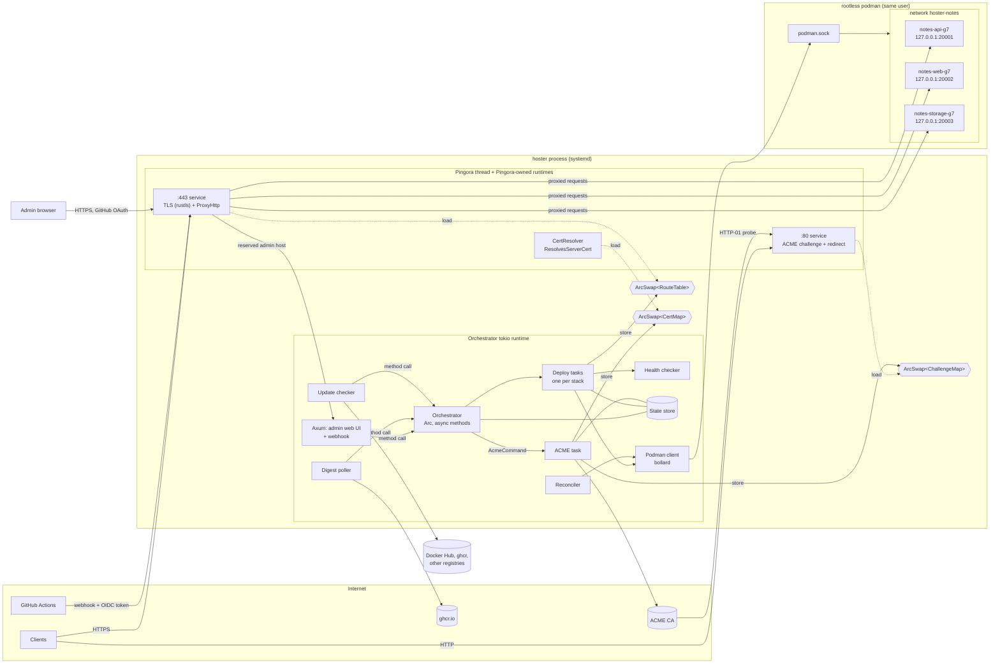
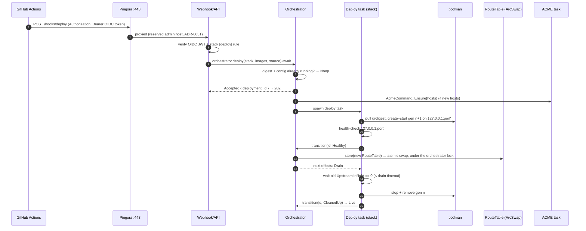

# hoster — architecture

Status: draft, 2026-11-07. Decisions referenced as **ADR-NNNN** are settled (see [adr/](adr/)).
Items marked **OQ-NN** are open; see [open-questions.md](open-questions.md).

## 1. Verified against

The library behaviour this design depends on was checked against crate sources and live systems on
2026-11-07, not taken from memory.

| Topic | Version checked | How it was checked | Finding |
|---|---|---|---|
| Pingora | `pingora` / `pingora-core` / `pingora-proxy` / `pingora-rustls` **0.9.1** (released 2026-11-03), MSRV 1.85 | crate source | See §1.1. |
| Pingora + rustls dynamic certs | pingora-core 0.9.1, `listeners/tls/rustls/mod.rs` | crate source | `TlsSettings::set_cert_resolver(Arc<dyn ResolvesServerCert>)` exists. When it is set, cert/key paths are ignored. The rustls backend does **not** call `TlsAccept::certificate_callback`; it logs a warning pointing to `ResolvesServerCert`. That callback only works on the OpenSSL/BoringSSL backends. `pingora-rustls` depends on `rustls 0.23` with the **`ring`** provider and installs it as the process default. Current rustls is 0.23.46. |
| instant-acme | **0.8.5** | crate source + `examples/provision.rs` | See §1.2. |
| bollard | **0.21.1** (bollard-stubs `=1.53.1-rc.29.3.1`) | crate source | See §1.3. |
| ghcr tag → digest | registry API, live | `curl` against `ghcr.io` | See §1.4. |
| Rootless podman, 127.0.0.1 publishing | podman **6.1.4**, netavark, pasta 2026_10_02, rootless | live probe through the compat API | See §1.5. |
| Supporting crates | `arc-swap` 1.9.3, `tokio` 1.54.1, `sqlx` 0.9.0 (ADR-0022) | crates.io | Current versions; no API concerns. |
| GitHub Actions OIDC (OQ-29) | discovery document, live | `curl` of `token.actions.githubusercontent.com/.well-known/openid-configuration` | Issuer `https://token.actions.githubusercontent.com`, JWKS at `/.well-known/jwks`, RS256. Claims include `repository_id`, `ref`, `ref_protected`, `environment`, `job_workflow_ref` and `jti`. |
| Admin UI stack (ADR-0021) | `axum` 0.8.9, `askama` 0.16.1, `oauth2` 5.0.0, `tower-sessions` 0.15.0, htmx.org **4.0.1** (npm, 2026-11-01; npm `latest` tag still points at 2.0.11, `next` at 4.0.1) | crates.io / npm registry | Versions noted for the plan. APIs not yet exercised. |
| Pingora Unix-socket upstreams | pingora-core 0.9.1 | crate source | `HttpPeer::new_uds(path, tls, sni)` exists, so the proxy can reach the admin Axum app over a Unix socket (ADR-0031). |
| Exec API, exec session removal, `Healthcheck NONE` (ADR-0056) | podman **6.1.4** (runc, rootless), bollard 0.21.1, checked 2026-11-09 | live, through the compat API and the podman-gated tests in `src/runtime/podman.rs` | See §1.6. |
| Container archive upload (ADR-0057) | podman **6.1.4** (runc, rootless, overlay); 5.7.0 and 5.4.2 rootful (crun); 5.7.0 rootless (CI, `ubuntu-26.04`); bollard 0.21.1 (source), checked 2026-11-10 | live through the compat API (curl); bollard's upload options checked in crate source; CI's live tests | See §1.7. |
| Resource limits, `ShmSize`, `Tmpfs`, `Init`, `OOMKilled` (ADR-0059) | podman **6.1.4** (runc 1.5.2, rootless, cgroup v2, systemd 262); delegation and crun in a throwaway Debian 13 systemd container (systemd 257, podman 5.4.2, crun 1.21); catatonit packages of Debian 13, Ubuntu 22.04/24.04 and Fedora 43; checked 2026-11-10 | live, through the compat and libpod APIs, the CLI and systemctl | See §1.8. |

### 1.1 Pingora 0.9.1

- **How `Server::run` works.** `Server::run(self, RunArgs)` blocks the calling thread. It builds
  its own tokio runtimes: one per service, sized by `ServerConf::threads` or a per-service
  override, plus a one-thread "Server" runtime for the main loop. It returns after shutdown.
- **Avoid `run_forever`.** `Server::run_forever()` calls `std::process::exit(0)`, and daemon mode
  forks. hoster uses neither.
- **Shutdown is pluggable.** `RunArgs { shutdown_signal: Box<dyn ShutdownSignalWatch> }` takes any
  async `recv() -> ShutdownSignal`, with variants `GracefulUpgrade`, `GracefulTerminate` and
  `FastShutdown`. The default watcher installs SIGQUIT/SIGTERM/SIGINT handlers. hoster supplies a
  channel-backed watcher instead, so signals stay with the orchestrator.
- **Readiness.** `Server::watch_execution_phase()` returns a broadcast receiver of
  `ExecutionPhase` (`Bootstrap` → `Running` → `GracefulTerminate` → … → `Terminated`). hoster uses
  `Running` as its "proxy is up" signal. Caveat (found while implementing): `Running` is sent
  when the main loop starts, *before* the service tasks bind their listeners, and a bind failure
  only panics inside the service task; Pingora keeps running without the listener. hoster
  therefore checks the listen address with a plain `bind` before spawning the thread and, after
  `Running`, waits until a TCP connect to the listener succeeds.
- **The grace period is a fixed sleep.** On `GracefulTerminate` Pingora sleeps the whole
  `grace_period_seconds` (an uninterruptible `thread::sleep`), even with no requests in flight.
  A later `FastShutdown` cannot cut it short, so a fast shutdown waits only briefly for the
  thread and then exits without it.
- **Grace period default.** `grace_period_seconds` defaults to **300 s**, and
  `graceful_shutdown_timeout_seconds` to 5 s. Both must be set explicitly so they fit systemd's
  `TimeoutStopSec`.
- **Running on its own thread is supported.** Nothing in `run` requires the main thread, so
  hoster runs it on a `std::thread` next to the orchestrator's tokio runtime. tokio channels work
  across runtimes.
- **Per-peer timeouts.** `PeerOptions` on `HttpPeer` exposes `connection_timeout`,
  `total_connection_timeout`, `read_timeout`, `write_timeout` and `idle_timeout`.
- **Proxy hooks.** `ProxyHttp` provides `early_request_filter`, `request_filter`, `upstream_peer`,
  `upstream_request_filter`, `response_filter`, `logging` and others. `logging` runs once per
  request on success or fatal error.

### 1.2 instant-acme 0.8.5

- **Flow.** `Account::builder()?.create(&NewAccount{..}, directory_url, None)` returns
  `(Account, AccountCredentials)`. `AccountCredentials` is serde (de)serializable for
  persistence, and `AccountBuilder::from_credentials` restores an account. An order goes
  `account.new_order(&NewOrder::new(&[Identifier::Dns(..)]))` → `order.authorizations()` →
  `authz.challenge(ChallengeType::Http01)`.
- **What to serve for HTTP-01.** The `ChallengeHandle` derefs to `Challenge { token, .. }`, and
  `key_authorization().as_str()` is the response body for
  `/.well-known/acme-challenge/<token>`. Then `set_ready()` → `poll_ready(&RetryPolicy)` →
  `finalize()` → `poll_certificate(&RetryPolicy)`.
- **Key generation needs `rcgen`.** `finalize()` generates the key and CSR and returns the private
  key PEM, but only with the `rcgen` feature. `finalize_csr()` takes your own CSR.
- **Renewal info.** ARI (`Account::renewal_info`, RFC 9773) is available behind the `time`
  feature.
- **Crypto provider.** The default features pull in **aws-lc-rs**, while Pingora uses **ring**.
  instant-acme has a `ring` feature, and hoster uses ring throughout (ADR-0037).

### 1.3 bollard 0.21.1

- **Podman is supported directly.** bollard documents podman as a first-class target.
  `Docker::connect_with_podman_defaults()` probes `$DOCKER_HOST` →
  `$XDG_RUNTIME_DIR/podman/podman.sock` → `/run/user/$UID/podman/podman.sock` → system socket.
  `connect_with_unix(path, timeout, version)` is the explicit form.
- **Pitfall: the API version must be negotiated.** bollard's `API_DEFAULT_VERSION` is **1.53**, but
  podman 6.1.4's Docker-compatible API reports **`ApiVersion` 1.44** (`MinAPIVersion` 1.24). The
  client must call `Docker::negotiate_version()` right after connecting, which downgrades to the
  server's version. Pinning 1.44 is the alternative. A `/v1.53/_ping` happened to succeed, but
  hoster must not rely on podman accepting versions it does not advertise.

### 1.4 ghcr tag → digest

Checked live against a public image:

1. `GET https://ghcr.io/token?scope=repository:<owner>/<name>:pull&service=ghcr.io` returns
   `{"token": …}`. This works anonymously for public images. Private images need basic auth with
   a GitHub username and a token that has `read:packages` (ADR-0025).
2. `HEAD https://ghcr.io/v2/<owner>/<name>/manifests/<tag>` with `Authorization: Bearer <token>`
   and an `Accept` header listing the OCI index, Docker manifest list, OCI manifest and Docker v2
   manifest media types returns `200` and `Docker-Content-Digest: sha256:…`.
3. Without a token the registry answers `401` with
   `WWW-Authenticate: Bearer realm="https://ghcr.io/token",service="ghcr.io",scope="repository:…:pull"`,
   so the token step can also be discovered generically.
4. `GET /v2/<owner>/<name>/tags/list?n=1000` with the same pull token returns
   `{"name": …, "tags": […]}` and, when more remain, `Link: </v2/…/tags/list?…&last=…>;
   rel="next"` with a relative target. Checked live on 2026-11-11 for the update checker
   (ADR-0061) on ghcr (`immich-app/immich-server`: 33,317 tags, most of them per-commit and
   per-PR CI tags) and Docker Hub (`library/postgres`: 1,433 tags). A full list of the larger
   one took a few seconds; the client gives up past 100,000 tags or 1,000 pages.

For multi-arch images the digest is the **index** digest. hoster records and compares the
requested reference digest, stored in a container label, rather than podman's image ID, which is
platform-specific.

### 1.5 Rootless podman publishing on 127.0.0.1

Probed through the Docker-compat API on `/run/user/1000/podman/podman.sock`, the same path bollard
uses:

1. Created a user-defined network (netavark bridge).
2. Created a container on it with `HostConfig.PortBindings = {"8000/tcp": [{"HostIp": "127.0.0.1", "HostPort": "18777"}]}`.
3. Started it and observed:
   - The listener is `127.0.0.1:18777`, owned by podman's **`rootlessport`** process.
   - `curl 127.0.0.1:18777` → 200.
   - `curl <host public IP>:18777` → connection refused.
   - Inspect reported `Ports: {'8000/tcp': [{'HostIp': '127.0.0.1', 'HostPort': '18777'}]}`.
4. Cleaned up the container and network.

Container IPs live inside the rootless network namespace and cannot be reached from the host. This
is why published loopback ports are the only path from the proxy to a container, which matches
ADR-0007.

**Tearing down the namespace on Ubuntu 26.04 (podman 5.7.0, passt 0.0~git20260120, apparmor
5.0.2).** Checked on a fresh, stock Ubuntu 26.04.1 host on 2026-11-11 (Bears ghd); GitHub's
`ubuntu-26.04` runner does the same. When the last running container on the rootless network
namespace stops or is force-removed, podman kills its `pasta` process, and AppArmor refuses it:
the kernel logs `apparmor="DENIED" operation="signal" profile="pasta" signal=term peer="podman"`.
26.04's apparmor package ships `/etc/apparmor.d/podman`, an unconfined profile that only gives
podman the label `podman` in place of `unconfined`, and passt's `usr.bin.pasta` profile has no
`signal` rule for that peer. Through the compat API (and the CLI):

- The stop or forced remove answers **500** `removing container <id> network: … rootless netns:
  kill network process: permission denied` (a remove prefixes `cleaning up container <id>: `).
- It did its job all the same: inspect says `exited` after the stop and 404 after the remove;
  `pasta`, `aardvark-dns` and the netns directory are gone; a later start works. A second stop
  is a 304.
- A stop that leaves another container running is a 204. `podman unshare --rootless-netns true`
  reproduces it on its own.
- Adding `signal (receive) peer=podman,` to `/etc/apparmor.d/usr.bin.pasta` and reloading it
  ends the 500. passt has the same fix upstream ("apparmor: Fix signaling issues from podman",
  Ubuntu LP #2154379); 26.04's archive does not ship it yet. The profile has no `local/` include.

hoster does not touch the host for this: `PodmanRuntime::stop` and `remove` treat a 500 that
mentions `rootless netns` as done when inspect confirms it (not running, or gone), and log a
warning; anything else stays an error.

### 1.6 Exec and podman's healthchecks (podman 6.1.4)

Checked live on a rootless podman 6.1.4 with runc, through the compat API (curl and the
`TEST_HOSTER_PODMAN=1` tests `exec_*`, `a_timed_out_exec_*` and
`podman_never_runs_an_images_healthcheck`):

- **Exec.** bollard's `create_exec` / `start_exec` (attached, `Connection: Upgrade`) /
  `inspect_exec` work against podman. The attached output closes when the exec's main process
  exits, even while a backgrounded child still holds stdout (`sh -c "sleep 4 & echo hi"` returns
  at once). Exec inspect reports `Running`, the host `Pid` while it runs (0 after) and
  `ExitCode`. Exit 0, a non-zero exit and a shell's 127 (`sh: pg_isready: not found`) are plain
  exit codes.
- **Cannot run.** When the OCI runtime cannot execute argv[0], the output is podman's one line
  `Error: runc: exec failed: unable to start container process: exec: "<argv0>": <reason>: OCI
  …` followed by `Error: read unixpacket @->/proc/self/fd/13/attach: read: connection reset by
  peer`, with exit 127 (`executable file not found in $PATH`), 126 (`permission denied`) or
  **125** (a directory, `is a directory: OCI runtime error`). hoster drops the trailer and treats
  a 125/126/127 whose only output is that `Error: … OCI …` line as "cannot run".
- **Not running.** An exec create on a stopped container is HTTP 500 `can only create exec
  sessions on running containers: container state improper`. A container stopped while an exec
  runs ends the exec (non-zero exit); hoster reports both as "the container is stopping or
  stopped".
- **Timeout.** The exec is its own process-group leader with a host PID; `kill(-pgid, SIGTERM)`
  ends it and its children, and exec inspect then shows exit 143. Outside a user namespace
  (a shell, not the shipped unit) hoster's uid, as the owner of podman's user namespace, can also
  signal an exec running as a non-root container user (a subuid); under the unit's
  `PrivateUsers=yes` it cannot, so such an exec is abandoned (§5.5). When the client drops the
  attached start request before it is answered, podman still runs the command, but exec
  inspect reports the session exited with 125 and `Pid` 0 while it runs, so it can be neither
  watched nor signalled.
- **Session removal.** `POST /v4.0.0/libpod/exec/{id}/remove` with body `{}` answers 200, and a
  second removal a JSON 404 with cause `no such exec session`. libpod routes are served only under
  a version prefix: the unversioned `/libpod/exec/{id}/remove` is the router's plain-text
  `404 Not Found`, the same answer as a podman without the route, so hoster always sends a
  version (any supported one; it uses 4.0.0). Compat container inspect lists the remaining
  sessions in `ExecIDs`.
- **`Healthcheck {Test: ["NONE"]}`.** A docker-format image with a `HEALTHCHECK` (written by
  compat commit) gets podman's check on a systemd user timer in a container created without
  `Healthcheck`. With `NONE` the check never runs and `State.Health` is null. Through the compat
  API podman fills in its defaults (`Interval` 30 s) and still registers a transient
  `<id>-<hash>.timer`/`.service` pair, but the timer never elapses (`NextElapseUSecMonotonic=
  infinity`, no trigger); `podman create --no-healthcheck` registers none.

### 1.7 Container archive upload (podman 6.1.4, 5.7.0, 5.4.2)

Checked live on a rootless podman 6.1.4 with runc and overlay, through the compat API (curl;
bollard's `upload_to_container` sends the same `PUT /containers/{id}/archive?path=`). A nested,
rootful podman 4.9.3 (`quay.io/podman/stable:v4.9.3`) behaved the same for `copyUIDGID`,
`noOverwriteDirNonDir` and the 404 stat, and so did nested, rootful podman 5.7.0 (Ubuntu 26.04)
and 5.4.2 (Debian 13) with crun 1.21 (2026-11-10: `copyUIDGID` gives `999:1000 0400` for
`User: 999`, the `HEAD` stat follows `/var/run` to `/run`, a read-only root refuses writes).
ADR-0057 requires podman 5.4. Rootless 5.x was first run on 2026-11-10: podman 5.7.0 on GitHub's
`ubuntu-26.04` runner, by the live tests in `src/runtime/podman.rs` that CI's `podman` job now
runs on every PR (owner and mode as root and as `1000:1000`, a read-only root, restarts, refused
files leaving no container). The findings below held there. Stopping the last running container
on that runner answers `rootless netns: kill network process: permission denied`, which is not
about uploads (§1.5). No rootless 5.4 and no SELinux host were tested.

- **Upload.** Into a created, unstarted container it answers 200, also with `ReadonlyRootfs`;
  into a running read-only container it fails. Files keep the tar header's uid, gid and mode,
  survive stop/start and go away with the container.
- **`copyUIDGID=true`.** Files, and every missing parent directory the upload creates, are owned
  by the container's user (`redis:7-alpine` with `User=999`: `999:1000 0755`). Existing
  directories are left alone. Without it, missing parents are created `0:0 0755`. Explicit
  directory entries create them with the header's owner and mode, and a later `copyUIDGID`
  upload leaves them alone.
- **Stat.** `HEAD /containers/{id}/archive?path=` answers 200 with `X-Docker-Container-Path-Stat`
  (base64 JSON with `isDir`, `mode` and `linkTarget`, the resolved path) for an existing path,
  following symlinks (`/var/run` in `alpine:3.20`: `isDir`, `linkTarget` `/run`). It answers 404
  for a missing path, and also for a dangling symlink, but then with the stat header (`nginx`'s
  `/var/log/nginx/access.log` → `/dev/stdout` before start); creating a directory there fails
  with `mkdir …: file exists`.
- **Symlinked ancestors.** A file uploaded under a symlink to a volume path (`/var/run/app/x.conf`,
  empty volume at `/run`) answers 200 and is copied up into the empty volume at first start; later
  generations read the volume's copy, not their own.
- **Container user files.** With a `User` not in the image's `/etc/passwd` (`12345`), podman
  appends a line for it to `/etc/passwd` at start, also to an uploaded one. On RHEL-family hosts
  podman's `mounts.conf` can mount host directories under `/run/secrets/`.
- **Directories.** A file over an image directory (`/etc/apk`) replaces it by default; with
  `noOverwriteDirNonDir=true` it fails with `file exists`.
- **Volumes.** An upload under an image `VOLUME` that holds content is silently lost. A file at an
  ancestor of a volume mount (`/data`, volume at `/data/db`) uploads, but the start fails with 500
  `identifying source directory for copy up into volume …: not a directory`.
- **Read-only root.** With `ReadonlyRootfs`, `/run`, `/tmp` and `/var/tmp` are tmpfs; uploaded
  files there are copied in at each start with their mode and stay writable by root, while
  `/etc/app/a.conf` gives `Read-only file system`. `/dev/shm` files are lost.
- **Errors.** An owner outside the user namespace (uid 70000) fails with 500 `error setting
  ownership …` inside a multi-KB `copier.request` dump that contains host storage paths, and can
  leave a partial file behind.
- **User gid.** A numeric `User` listed in the image's `/etc/passwd` runs with its passwd gid
  (`999` in `redis:7-alpine` is `999:1000`); an unlisted uid gets gid 0.

### 1.8 Limits, runtime options and OOM (podman 6.1.4)

Checked live on rootless podman 6.1.4 with runc 1.5.2, cgroup v2 and systemd 262 (user manager
delegating `cpu memory pids`, the upstream default since systemd 252), through the compat and libpod
APIs and the CLI:

- **Fields.** `Memory`, `MemorySwap`, `NanoCpus`, `PidsLimit`, `ShmSize`, `Tmpfs` and `Init`
  are accepted without warnings, echoed by inspect and in force inside: `memory.max`,
  `memory.swap.max`, `pids.max`, `cpu.max` (`NanoCpus` 1.5e9 becomes `CpuQuota` 150000 /
  `CpuPeriod` 100000) and the `/dev/shm` size. `Init: true` makes PID 1 `/run/podman-init`
  (catatonit, bind-mounted from the host); a missing init binary fails at create ("container-init
  binary not found on the host", seen with the CLI).
- **Defaults when unset.** No memory or CPU cap (`cpu.max` `max 100000`), `PidsLimit` 2048 from
  containers.conf, `ShmSize` 65536000.
- **Swap.** `Memory` with `MemorySwap` unset, 0 or -1 gives `MemorySwap` = 2 × `Memory`
  (`memory.swap.max` equal to the limit). Only `MemorySwap` = `Memory` gives `memory.swap.max` 0.
- **Odd values.** `PidsLimit` 0 gives `pids.max` 1 (the container cannot fork), -1 gives `max`.
  `ShmSize` 0 falls back to the default. 4 MiB of memory is accepted (no podman floor, CLI
  included); 0.001 CPU is accepted and raised to `cpu.max` `1000 100000`, the kernel's minimum
  quota.
- **Tmpfs.** Podman appends `rprivate,tmpcopyup`. Without `mode=`, a path missing from the image
  (or 1777 there, like `/tmp`) comes out 1777, but an existing directory keeps its image mode and
  becomes `root:root`: `/var/cache/nginx` in `nginx-unprivileged` (`775 nginx:root`) turns
  `775 root:root` and uid 101 cannot write; with `mode=1777` it can. `noexec` really blocks exec
  (126). With `ReadonlyRootfs`, podman mounts unsized,
  exec-allowed tmpfs on `/tmp`, `/run` and `/var/tmp` (`read_only_tmpfs`, which only libpod can
  turn off); a `Tmpfs` entry replaces podman's mount at its path only. Tmpfs and shm pages are
  charged to the memory cgroup: writing past `memory` OOM-kills the writer.
- **OOM.** `State.OOMKilled` is false during a container's first run, even after a child was killed,
  and true at any later exit once an OOM kill happened in its cgroup, also with exit 0 or after a
  normal stop (143). It is sticky across `start`: after an OOM exit (137, true), starting the same
  container again shows `running` with true, and a later run that exits 1 without any OOM still
  reports true. Only a new container resets it. A killed PID 1 exits 137, with or without `Init`.
  The kernel picks the victim (`memory.oom.group` 0), so a child's allocation can kill PID 1. Podman
  emits no `oom` event, only `die`. While a container runs, the only signal is `oom_kill` in
  `/sys/fs/cgroup<State.CgroupPath>/memory.events`.
- **Controllers.** Compat `/info` reports `CpuCfsQuota` and `SwapLimit` false although both work.
  libpod `/info` `host.cgroupControllers` lists the controllers of podman's own cgroup, not what
  containers get: run from a cgroup with none it returns `[]`, yet a `--cpus 0.5 --memory 64m
  --pids-limit 50` container started from there gets all three, since containers land in libpod
  scopes under `user@<uid>.service`. What containers can use is that unit's `cgroup.controllers`,
  which `ProtectControlGroups=yes` leaves readable. A limit on an undelegated controller (`io`,
  `cpuset` here) is accepted at create and fails at start (HTTP 500 from runc; crun 1.21 likewise:
  "controller `cpuset` is not available"), leaving the container `created`.
- **Delegation.** Upstream `user@.service` has `Delegate=pids memory cpu` since systemd 252; Ubuntu
  22.04 (systemd 249) ships `pids memory`. `Delegate=` lists in drop-ins add to the unit's (an
  empty assignment resets). After changing the drop-in, `daemon-reload` updates the unit's
  `DelegateControllers` but not the running manager's `cgroup.controllers`; only a restart of
  `user@<uid>.service` (or a reboot) applies it (systemd 257).
- **Init.** libpod `/info` reports no init path; that is containers.conf `init_path`, default
  `/usr/libexec/podman/catatonit`. The `catatonit` package puts it there on Debian 13, Ubuntu
  22.04 and 24.04 and Fedora 43; Arch uses `/usr/lib/podman/catatonit`.

## 2. Component overview



The admin web UI and the webhook are one Axum app. It is reached through a reserved admin-host
route in Pingora. Pingora reaches it through a Unix-socket upstream (ADR-0031).

### 2.1 Components

| Component | Runs on | Responsibility |
|---|---|---|
| **Supervisor** (`main`) | main thread → orchestrator runtime | Loads config, builds the orchestrator runtime, starts everything in order (§4), owns OS signals, coordinates shutdown. |
| **Orchestrator** | orchestrator runtime, `Arc<Orchestrator>` shared by all callers (ADR-0050) | The single writer of desired state. Exposes async methods (`apply`, `deploy`, `remove`, `rollback`, `status`, `transition`) to the web UI, webhook, poller and reconciler; applies idempotency by digest and config hash; enforces at most one deploy per stack; spawns deploy tasks; owns `ArcSwap<RouteTable>` writes. One internal `Mutex<State>` held only for in-memory work. |
| **Deploy task** | orchestrator runtime, one per active stack deploy | Runs the deploy state machine (§5) for one stack by executing effects and calling `orchestrator.transition(id, event)` after each step. |
| **Reconciler** | orchestrator runtime | Startup: compares persisted state with `podman ps` by label, then adopts, restarts or removes containers. Periodic (about every 15 s): restarts exited containers with backoff and flags CrashLooping (ADR-0028). Both passes visit containers in `depends_on` order, read from the last committed deployment's revision, and start one only once its dependencies are running and have passed their check since hoster (re)started them or first saw them running: without a bound while a dependency is down, for at most min(`start_period`, 5 min) while it runs without passing (§5.5). The startup pass defers unready containers to the periodic loop, which starts them as startup starts, not restarts (ADR-0056). Each restart records the exit reason, naming an OOM on an exit 137 with `OOMKilled` true or on an exit where that sticky flag turned true since hoster last saw it (ADR-0059). |
| **Podman client** | orchestrator runtime | A thin `ContainerRuntime` trait over bollard (network, pull, create, start, stop, remove, inspect, list, logs, exec). Finished exec sessions are removed, best effort, with a raw libpod call over the same socket (ADR-0056, §5.5). Production uses `PodmanRuntime`; tests use a fake. |
| **State store** | orchestrator runtime | SQLite via sqlx (ADR-0022): `SqlitePool`, WAL mode, embedded migrations, compile-time checked queries. Persists stacks, deployments, digests, generations, port allocations, deploy history, sessions. |
| **Health checker** | orchestrator runtime | Probes new containers before the swap with the service's check: HTTP or TCP on their `127.0.0.1` port, or an exec inside the container (ADR-0038, ADR-0056, §5.5). Afterwards, periodic probes feed status only. |
| **ACME task** | orchestrator runtime, single task | Account lifecycle, issuance, renewal. Writes `CertMap` and `ChallengeMap`. Persists account and certs to disk. |
| **Registry client** | orchestrator runtime | Generic OCI distribution client (ADR-0025): token discovery from `WWW-Authenticate`, `HEAD` manifest → digest, and paginated tag lists. Per-registry-host credentials. Used by the poller, the update checker and for resolving third-party tags at stack apply. |
| **Digest poller** | orchestrator runtime | Periodically resolves tracked ghcr tags to digests. Calls `orchestrator.deploy` only when a tag's observed digest changes (ADR-0043). |
| **Update checker** | orchestrator runtime | Checks third-party images for updates (ADR-0061), every 6 h by default with jitter (Settings → Updates, "Check now"). Sees moved tags by `HEAD` and newer versions in the same line from the tag list, backing off per registry on 429. Stores the last check of each service in `image_checks` and the highest candidate of each kind in `image_updates`, recording newly found ones in the event log (`UpdateAvailable`, never mailed) and announcing `UiEvent::Updates`. For services with `auto_update`, applies a stack's allowed candidates as one new revision and one `AutoUpdate` deployment through the orchestrator, skipping stacks with an active or queued deployment; each candidate is acted on once. |
| **Notifier** | orchestrator runtime | Mails the operator about problems and recoveries (ADR-0058). Reads the event log (§11) past a persisted cursor, woken by `ui_events` and a one-minute timer; selects, de-duplicates and rate-limits; delivers through a mail `Provider` (Resend) with a short retry, and records `NotificationFailed` when it gives up. Idle until notifications are configured in Settings. Beyond ADR-0058 §7–§8 it keeps the open problems true to what the producers still know: a cancelled deploy (`DeployFailed`, warning) is not mailed; a successful deploy, or a rollback that went live, forgets the stack's crash-loop and health problems, since their generations are gone; `HosterStarted` forgets all of those, which the reconciler and health monitor write again if they persist; `StackRemoved` forgets every problem of the stack, its hosts' included. Open problems with no repeat event are reminded of from the timer, a day after their last mail (deploy problems never). The hourly cap and its held-back count live in memory. |
| **Traffic recorder** | orchestrator runtime, single task | Drains the proxy's per-route `Traffic` counters just after every minute and writes them as minute rows, rolled up into hour rows, in one transaction (ADR-0062, §12). Sweeps both tables to their retention and flushes once more on graceful shutdown. |
| **Admin web UI + webhook (Axum)** | orchestrator runtime | One Axum app (ADR-0021).<br/>• **UI:** Askama-rendered pages with vendored HTMX 4 (embedded in the binary). GitHub OAuth login, restricted to `HOSTER_ADMIN_GITHUB`. SQLite sessions and CSRF tokens (ADR-0031).<br/>• **Webhook:** `/hooks/deploy`, authenticated with a GitHub Actions OIDC token (signature via a cached JWKS, `iss`, `aud`, expiry, single-use `jti`) and authorized by the stack's `[deploy]` rule (ADR-0047).<br/>• **Wiring:** calls `Orchestrator` methods directly and renders their typed results. Live views (deploy progress, logs) stream through SSE or HTMX polling. |
| **GitHub OAuth client** | orchestrator runtime | Authorization-code + PKCE flow against github.com. Compares the login handle case-insensitively with `HOSTER_ADMIN_GITHUB` (ADR-0031). |
| **:80 service** | Pingora | Answers `/.well-known/acme-challenge/<token>` from `ChallengeMap`. Redirects every other request to `https://` with 308. |
| **:443 service** | Pingora | TLS via rustls with `CertResolver`. `ProxyHttp` routes against `RouteTable`. |
| **CertResolver** | Pingora handshake path | `impl rustls::server::ResolvesServerCert`. Looks up SNI in `CertMap`. |

## 3. Threads, runtimes and channels

### 3.1 Threads

```
process hoster
├── main thread ── #[tokio::main] orchestrator runtime (multi-thread, N workers)
│                  supervisor, orchestrator, deploy tasks, ACME, poller, update checker, API, reconciler, notifier,
│                  traffic recorder
└── "pingora" std::thread ── pingora_core::server::Server::run(RunArgs{ custom watcher })
                 ├── Pingora "Server" runtime (1 thread): main loop, awaits our ShutdownSignalWatch
                 ├── ":80" service runtime  (ServerConf.threads or per-service override)
                 └── ":443" service runtime (ServerConf.threads)
```

- The proxy's hot path never shares a runtime with orchestrator work. A slow image pull or a
  blocking podman call cannot add latency to requests, and the reverse is also true.
- The proxy's threads count requests in lock-free atomics (`Traffic`); the traffic recorder on
  the orchestrator runtime drains them once a minute into SQLite (§12, ADR-0062), so the hot path
  never touches the store.
- The Pingora thread is spawned **after** the initial state is loaded (§4). That way the first
  request already sees a populated `RouteTable` and `CertMap`.
- `ServerConf` is built in code: `daemon = false`, no upgrade socket, explicit
  `grace_period_seconds` and `graceful_shutdown_timeout_seconds`, `threads` from hoster config.
  Pingora's own CLI/YAML parsing is not used.

### 3.2 Shared state: ArcSwap snapshots

The Pingora side reads all mutable state through lock-free `ArcSwap::load()` on immutable
snapshots. Every snapshot has exactly one writer.

| Snapshot | Type (sketch) | Writer | Readers | Update pattern |
|---|---|---|---|---|
| `RouteTable` | `ArcSwap<RouteTable>` | Orchestrator (inside `transition`, ADR-0050) | :443 `ProxyHttp` | Rebuild the whole table from desired state, then `store`. |
| `CertMap` | `ArcSwap<HashMap<String, Arc<CertifiedKey>>>` | ACME task (and startup loader) | `CertResolver` | Clone, insert/replace one host, `store`. |
| `ChallengeMap` | `ArcSwap<HashMap<String, String>>` (token → key authorization) | ACME task | :80 service | Insert before `set_ready()`; remove when the order finishes. |

`RouteTable` entries hold `Arc<Upstream>`:

```rust
struct Upstream {
    addr: SocketAddr,           // 127.0.0.1:<allocated>
    stack: StackId, service: ServiceName, generation: u64,
    inflight: AtomicU64,        // requests currently proxied to this upstream
}
```

The proxy increments `inflight` when it picks an upstream. It keeps an RAII guard in the request
`CTX` that decrements on drop, so cancelled and errored requests are counted correctly. The deploy
task keeps its own `Arc<Upstream>` for the old container. After the swap it watches `inflight`
reach zero to know the drain is done (§5.3). No message from the proxy is needed.

### 3.3 Channels

Requests into the orchestrator are **method calls** on `Arc<Orchestrator>` (ADR-0050): the web
UI, webhook, poller, update checker and reconciler call `apply`, `deploy`, `remove`, `rollback` and `status` and
receive typed results; deploy tasks call `transition(deployment_id, event)`. Channels are used only
where a boundary needs them:

| # | Channel | Type | From → To | Purpose |
|---|---|---|---|---|
| 1 | `acme_tx` | `mpsc::UnboundedSender<AcmeCommand>` | Orchestrator → ACME task | `Ensure { hosts }` with the hosts of a stack's active revision at every apply and rollback, and for every stack's active revision at startup (deployed or not); `Forget { host }` when no active revision routes a host any more; `Retry { host }` from the certificates page's "Retry now" (refused by the web UI while the host's persisted backoff runs, and skipped by the task while backing off or when the certificate is not due). Sent under the orchestrator lock, so the order is kept and an apply never waits for an issuance. |
| 2 | `acme_events` | `mpsc::Sender<AcmeEvent>` | ACME task → Orchestrator | `Issued { host, not_after }`, `Failed { host, error, retry_at }`, `DnsMismatch { host, observed, expected }` (advisory, ADR-0051). The orchestrator records them and fans them out on `ui_events` (#5), so each channel has one producer. Used for status ("TLS pending") in the UI; deploys never wait on certificates (ADR-0036). |
| 3 | `pingora_shutdown` | `watch::Sender<Option<ShutdownSignal>>` | Supervisor → Pingora "Server" runtime | Read by our `ShutdownSignalWatch` impl. SIGTERM becomes `GracefulTerminate`, a second SIGTERM or SIGINT becomes `FastShutdown`. |
| 4 | `pingora_phase` | `broadcast::Receiver<ExecutionPhase>` | Pingora → Supervisor | `Running`, followed by a successful connect to the listener (§1.1), means the listeners are bound and the ACME task may start. An early `Terminated` means Pingora died, and the supervisor exits non-zero. |
| 5 | `ui_events` | `broadcast::Sender<UiEvent>` | Orchestrator → Axum SSE handlers, notifier | Deploy progress, health changes, cert events (relayed from #2) and newly recorded events of the event log (§11), pushed to open UI pages (HTMX SSE). Lagging receivers just re-render from current state. The notifier (ADR-0058) uses it only as a wake-up and reads the events themselves from the store. |
| 6 | `shutdown` | `CancellationToken` (tokio-util) | Supervisor → all orchestrator tasks | Cooperative cancellation. Deploy tasks stop at the next safe point (§5.4). |



The orchestrator performs the swap inside `transition`, not the deploy task. A single writer
builds `RouteTable` from the full desired state of every stack, so concurrent deploys of different
stacks can never overwrite each other's routes (ADR-0035 #1, ADR-0050).

## 4. Startup and shutdown order

**Startup**

1. Parse config (`~/.config/hoster/hoster.toml` + `HOSTER_*` env, ADR-0024) and initialize tracing.
   Raise the soft `RLIMIT_NOFILE` to 16384 and log it with the connection cap it gives (§9.1,
   ADR-0065).
2. Open the SQLite state store (sqlx pool, WAL mode) and run the embedded `sqlx::migrate!()` migrations.
   Every migration is a reversible `.up.sql` / `.down.sql` pair (`sqlx migrate add -r`), so a newer
   binary can undo the schema for an older one (ADR-0052).
3. Load the certificates on disk into `CertMap`. Expired ones are skipped and queued for
   issuance.
4. Connect to podman, run `negotiate_version()` and `ping()`. The socket comes from the same
   user's `podman.socket` unit (ADR-0023). Fail fast with a clear message if it is missing.
5. Reconcile: list containers by the `hoster.managed=true` label and compare with persisted
   state. Adopt running containers of the current generation, start or recreate missing ones,
   remove orphans from interrupted deploys (§5.4). A container whose `depends_on` services are not
   yet running and passing is deferred to the periodic reconcile loop, so this step never waits on
   a probe. The loop starts it as a startup start, with no restart record or backoff, even once its
   hold runs out; in that case it writes the past-hold event (§5.5, ADR-0056).
6. Build and store the initial `RouteTable`.
7. Spawn the Pingora thread and wait for `ExecutionPhase::Running`. If it fails to bind :80/:443,
   exit non-zero so systemd shows the failure.
8. Start the ACME task (renewals plus any missing certs, the admin host included), the poller, the
   notifier (ADR-0058), the traffic recorder (its retention sweep first, §12) and the Axum app
   (web UI + webhook). Requests the proxy served before the recorder's first tick are in the
   in-memory counters and land in that tick's minute.
9. Notify systemd that the service is ready (`READY=1` with `Type=notify`).

**Shutdown** (SIGTERM, or the graceful shutdown the System page requests after a self-update
switched `current`; `Restart=always` then starts the new binary, ADR-0052)

1. Cancel the poller and the Axum app, and stop accepting new commands.
2. Let in-flight deploy tasks reach a safe point (§5.4), then persist.
3. Send `GracefulTerminate` to Pingora. Pingora stops accepting, waits `grace_period_seconds`,
   then shuts its runtimes down with `graceful_shutdown_timeout_seconds`.
4. Join the Pingora thread.
5. Flush the traffic recorder once more, so the requests of the partial minute are written
   (§12). The recorder has its own stop token rather than a child of the root token (§3.3
   #6), so it keeps counting until the proxy is joined; a fast shutdown waits at most 5 s for
   this flush. Then exit 0.

App containers keep running when hoster stops. They are owned by podman/conmon, not by the
hoster process. While hoster is down there is no proxy, so the apps are unreachable for about 1–2 s (ADR-0034).

## 5. Deploy state machine

### 5.1 States

A **deployment** is one attempt to move a stack from its current digest set to a target digest set.
It is persisted with every transition, so a crash can be recovered from (§5.4).


| State | Work | Side effects | On failure |
|---|---|---|---|
| **Received** | Compare target digests with running ones per service. | none | — |
| **Validating** | Parse the stack, check route collisions against other stacks' routes, allocate new ports for routed services that change, assign generation *n+1*. Reject a limit whose cgroup controller `user@<uid>.service`'s `cgroup.controllers` does not list (or that file cannot be read); apply runs the same check before resolving images (ADR-0059). | Port allocations reserved (persisted). | → `Rejected`, reservations released. |
| **Pulling** | Pull every changed image `repo@digest`, with credentials if configured. Fail if a config file is equal to, under or an ancestor of an image `VOLUME` (ADR-0057). | Images in local storage. | → `Aborting`. |
| **Starting** | Ensure network `hoster-<stack>`. For each changed **start-phase** service (see below) that is not held back and has no `depends_on` service left to start in this phase, create and start `hoster-<stack>-<svc>-g<n+1>` with labels, the network alias `<svc>`, and `127.0.0.1:<port>` publishing for routed services. | New containers running next to the old ones. | → `Aborting`. |
| **HealthChecking** | Probe the started start-phase containers concurrently, each by its check (§5.5), until it passes, it times out, or the container exits (the abort names an OOM kill, ADR-0059). As soon as every in-phase dependency of a waiting service has passed, create and start it and probe it too (a start wave). Services held back for the replace phase (below) are not started here. Done when every other start-phase container has passed. | Dependents' containers created and started. | → `Aborting`; dependents not yet started are never created. |
| **Replacing** | For each changed **replace-phase** service, one at a time in dependency order, name as tie-break (ADR-0048, ADR-0056): publish a `RouteTable` with its routes `Unavailable`, stop the old container (keep it), start the new one, probe it (an exit aborts, naming an OOM kill, ADR-0059). Start each held-back start-phase service, and probe it, once its dependencies have passed, after re-checking that its unchanged dependencies run; a replacement that depends on one waits for it. After a replacement passes, start again, in dependency order, every unchanged service depending on it that was running when the deployment began and has exited since (no restart record), and probe each within its `start_period` before any changed service depending on it starts. Empty when no replace-phase service and no held-back service exists. | Old stop-first containers stopped; new ones running. 503 for their routes meanwhile. | → `Aborting`. |
| **Switching** | The deploy task calls `transition(id, Healthy)`. The orchestrator rebuilds `RouteTable` with every changed service's new upstream and `store`s it, then writes all per-service pointers in one transaction. | Traffic moves atomically for the whole stack. | Cannot fail once in memory. A persist failure is fatal and logged; the reconciler fixes it at next start. |
| **Draining** | Wait for `old_upstream.inflight == 0`, polled every 100 ms, or for the per-stack drain timeout. Keep-alive connections that are idle at Pingora's upstream pool are fine. New requests already go to the new upstream, and the old container is only stopped after this state. | none | Timeout → proceed; long-lived requests (SSE, WebSockets) get cut. |
| **CleaningUp** | Stop old containers (SIGTERM, then the stop timeout), remove them, release their ports. | Old generation gone. | → `LiveWithWarnings`. The reconciler garbage-collects later. |
| **Aborting** | Stop and remove the new generation's containers in reverse creation order, start any stop-first containers that `Replacing` stopped, in the dependency order of the last committed deployment's revision (order only: edges to services without a current pointer are ignored, and nothing waits for running or health; whatever does not come up is left to the reconciler), restore their routes, release reserved ports. | Back to the previous state. | Leftovers labelled with the aborted generation are GC'd by the reconciler. |

Non-routed services (no ports, e.g. a worker) follow the same sequence. They have no upstream to
swap, so "Switching" only records the new generation and draining is skipped. Services that must
not run twice at once, e.g. anything holding an exclusive lock on a volume, need a stop-first
variant, `update = "stop-first"` (ADR-0039). Stop-first services that have a previous generation
are replaced in the `Replacing` step, after every start-phase service except held-back ones is
healthy and before the single swap, so a deployment is always one atomic change to the stack
(ADR-0048).

**Phases and start waves (ADR-0056).** The changed services split into two phases:

- The **start phase** is every changed start-first service plus every changed stop-first service
  **without a previous generation**. Such a service has nothing to stop and opens no gap, so a
  first deploy of a stop-first `db` and an `app` that depends on it starts `db` first.
- The **replace phase** is every changed stop-first service with a previous generation.

Within the start phase a service starts once each `depends_on` service *in the start phase* has
passed its probe. Services whose dependencies have all passed start together, so independent
services still start and probe in parallel. Creates run one at a time, each after an interruption
check; only the probe waits are dropped on cancel or removal. A stack without `depends_on` behaves
exactly as before: everything starts in `Starting` and `HealthChecking` only probes.

- A dependency that is unchanged in the deployment must have a running current container, or
  the deploy fails (`db (unchanged) is not running`). This is checked at the start and again
  before each held-back start, since an unchanged service may exit on the lost connection while a
  replaced dependency is down (`app -> cache (unchanged) -> db (replaced)`). Its monitor status is
  written to the deployment log but not waited on. When the deployment begins it records which
  unchanged services are running. After a replace-phase service passes, `Replacing` starts again,
  in dependency order, each unchanged service depending on it (directly or transitively) that was
  running then and has exited since: no restart record, backoff or event. Each is probed with its
  own check within its `start_period` before any held-back or replace-phase service depending on
  it starts, so `app` never starts against a `cache` still starting up; a failed probe aborts the
  deploy (ADR-0056 2.4). An unchanged service that was already stopped (in reconciler
  backoff or crash looping) is left to the reconciler and its crash-loop accounting.
- A dependency that has never run (awaiting its first digest, `ServiceState::AwaitingFirstDigest`)
  and is not part of the deployment is ignored, as the reconciler ignores a dependency without a
  current pointer. The dependent deploys with its requested digest and the deployment log says
  `api has never run; starting web without it`. Holding it instead would drop the digest: `Plan`
  keeps no pending digest and leaves `awaiting` services out of its target.
- A start-phase service that depends, directly or transitively, on a changed replace-phase
  service is **held back**: `Replacing` creates it once that dependency has been replaced and has
  passed, so it is never probed against the old dependency. Its own old generation keeps serving
  until `Switching`, so it opens no gap of its own. But gaps close only at `Switching` (or the
  abort), so its start and probe add to the 503 gap of every replace-phase service already stopped
  in this deployment, not only its dependency's. A replace-phase service's start-phase dependencies
  have all passed already, except held-back ones, which `Replacing` starts before it.
- There is no deploy-wide timeout: a dependency chain takes the sum of its probe times.
- Inside a deployment, dependencies and checks come from its target revision. Everywhere else (the
  reconciler and its gate, the monitor, and `Aborting`'s restart order) they come from the
  revision of the last committed deployment, the source `committed_definition` already uses for
  routes, never from the latest revision, which after a failed or rejected deploy is not the one
  running. The monitor moves from `latest_revision` to that source.

The per-deployment log gets one line per wave (`starting db, cache`, `db healthy after 3s 241ms;
starting app`, `replacing db (stop-first)`, `starting app (held back for db)`), each pass in the
start phase is recorded (the settle check's too, as `worker healthy after 5s 3ms`), and every
deployment shows the check in force for each service (`checking db with exec: pg_isready -U app,
declared in health.exec`) before its probe lines. The ADR-0055 `failed` event names the failing
service and the dependents that were never started.

The admin UI shows the same model (ADR-0054). The apply preview lists the start order from
`Plan::start_order`: the start phase as levels of its start waves (each service with the
start-phase dependencies it waits for), then `Replacing`'s replace-phase and held-back services
one at a time. The levels are only a summary: a service still starts as soon as its own
dependencies pass. The stack overview shows each service's `depends_on` and the check in effect
(`health::CheckSpec`, the precedence of §5.5 in the same words as the deploy's, without ports),
both from the same source as the reconciler and the monitor (`StackStatus::committed`, the last
committed deployment's revision, else the active one), and the reconciler's "waiting for db" while
the container is known not to run. A deployment's page tags these notes `wave`, `check` and
`probe` by `orchestrator::NoteKind`, which reads the words the engine writes them with
(`orchestrator::notes::Note`) and the health check's (`ProbeOutput::is_probe`), and shows an exec
probe's output tail collapsed, read back from the event text by `health::ProbeOutput`.

**Generations and the commit point.** The generation counter is per stack and is assigned to each
deployment attempt, but it is **recorded per service**: a deployment recreates only the services
whose digest or config hash changed, so after a webhook that updates `api` alone, `api` is at
g*n+1* while `web` and `storage` stay at g*n* (stack-format §3.1). The durable truth is therefore
the set of per-service current pointers (generation, digest, config hash, ports) for the stack.
The commit point of a deployment is the single transaction that writes all of them.

The state machine is implemented once, as a pure transition function with the full state set
above, and is already in place in M3 before the proxy exists. There, `HealthChecking` uses only
the built-in "running for 5 s" check, `Switching` writes the pointers without publishing a
`RouteTable`, and `Draining` completes at once. M6 replaces those effects with real probes, the
swap and the inflight drain without changing the states or transitions.

### 5.2 Idempotency and coalescing

- **Running-set check.** The orchestrator keeps, per stack, the (digest, config hash) each service
  is running (in memory, backed by the store). `Deploy` with an identical set → `Noop` (ADR-0005 as
  refined by ADR-0029). The check applies to the
  webhook, the poller and manual deploys alike.
- **One deploy per stack.** While a stack has an active deployment, new commands for it are
  queued (ADR-0040). The queue keeps only the newest target, and when the active deploy
  ends the orchestrator re-runs the idempotency check against it. Different stacks deploy in parallel.
- **Auto-updates don't queue.** The update checker skips a stack that has an active or queued
  deployment and tries again on its next pass, so it never takes the pending slot (ADR-0061).

### 5.3 Draining

- **Mechanism.** Draining relies on per-upstream `inflight` counters (§3.2). Each new container
  gets a fresh port, and Pingora keys its upstream connection pool by peer address. So no pooled
  connection to the old container can be reused for a request routed to the new one. Idle pooled
  connections to the old port die when the container stops, and that is harmless because no new
  request is ever routed there.
- **Edge case.** A request may have loaded the old `RouteTable` snapshot just before the swap but
  not yet incremented `inflight`. The deploy task waits a short **settle delay** (e.g. 1 s) after
  the swap before it starts checking `inflight == 0`.

### 5.4 Crash recovery

Each persisted state tells the reconciler what to do at startup:

| Persisted state at crash | Recovery |
|---|---|
| `Validating`, `Pulling` | Mark `Failed (interrupted)`, release reservations. |
| `Starting`, `HealthChecking`, `Replacing` | Remove containers of generation *n+1* (every start wave's containers are generation *n+1*, so no wave index is persisted), start any stopped stop-first containers of the previous generation, mark `Failed (interrupted)`. The old generation keeps serving; a start-phase stop-first service without a previous generation is simply absent. |
| `Switching` with the per-service pointers not yet written | The swap never happened in a running proxy (the table is in memory), so treat it like `HealthChecking`. |
| `Draining`, `CleaningUp` (pointers written) | The new pointers are authoritative: remove the containers of every service's previous generation, mark `Live`. |

The per-service current pointers are the one durable fact that decides which containers are
routed. Writing them in one transaction is the commit point of a deploy (§5.1).

### 5.5 Health checks and exec probes

The deploy probes and the live monitor use the same check, resolved from the revision (ADR-0038,
ADR-0051, ADR-0056):

1. A declared probe: `health.http` or `health.tcp` (routed services only), or `health.exec` (any
   service). At most one may be set, and a `health` table on a non-routed service must set `exec`.
2. Otherwise `GET /healthz` on the first route's container port for a routed service, and
   "running and not restarted for 5 s" for the rest. A routed service's timings-only `health`
   table keeps that default probe with its own timings, and events and the overview call it the
   default.

On a routed service an exec check is paired with a TCP connect to the first route's loopback port
and passes only when both do: an in-container check cannot see the published port.

**Config hash.** `exec` adds a key only when set, so no existing hash changes. Changing the argv or
its timings changes the hash, like any other `health` change.

**What the spike found** (podman 6.1.4, rootless, the shipped unit). A compat exec costs about
90 ms. Exec has no timeout. Podman removes a finished compat exec session itself after
`exit_command_delay` (300 s by default, `containers.conf`). hoster never set `Healthcheck` at
create, so docker-format images got podman's own systemd-timer
check; `Healthcheck {Test: ["NONE"]}` turns it off (§1.6). (Podman drops the check from OCI-format images
when it stores them, one reason ADR-0056 does not use it as a default.) While a container is
stopping, compat inspect still reports `running` (libpod says `stopping`), but an exec create
already fails.

**Running an exec check.** The exec is created with the argv and no `Env`, `User` or
`Privileged`, so it runs, without a shell, as the container's user with its environment. Exit 0
passes. The check **cannot run** only when podman itself could not execute argv[0]: its OCI
runtime error text (`executable file not found`, `permission denied`, `is a directory`) is then
the only output, with exit 125, 126 or 127 (§1.6). A
deploy then aborts at once with a reason built from that text, e.g. "`health.exec` cannot run:
`pg_isready`: executable file not found". In the monitor it is plain `Unhealthy` with the reason.
Any other exit, including a 126/127 that a shell or script returns for an inner command
(`["sh", "-c", "curl …"]` without curl, or a binary a volume provides a moment after start), is an
ordinary failure retried until the deadline. Exec defaults are `interval = "1s"`,
`timeout = "5s"`, `healthy_after = 1` and `start_period = "30s"`; http and tcp keep
`timeout = "2s"`.

- **Output.** It goes into a 4 KiB ring. The last 256 characters go to the deployment log as one
  escaped line, with podman's `read unixpacket` trailer stripped and secret values of 4 or more
  characters redacted, as is each trimmed line (4+ characters) of a secret used as a file
  (ADR-0057). The monitor, SSE and the ADR-0055 event log record the exit code only.
- **Timeout.** The probe fails at `timeout` whether or not the exec ends, and the deploy deadline
  never waits for it. hoster reads the exec's host PID while the session is `Running`, opens a
  pidfd for it, re-inspects that the session is still `Running` with that PID, and reads the
  process group (`getpgid(2)`). The exec is its own process-group leader, and
  `pidfd_send_signal` reaches only that one process, so hoster checks through the pidfd that the
  leader is alive and still leads that group, then signals the group with `kill(-pgid)`: SIGTERM,
  then SIGKILL 1 s later, also when the leader has exited, so a member that ignores SIGTERM goes
  too (`ESRCH` means every member is gone). The group stays reserved while any member lives, so
  the only race is the leader and every member exiting before the kill and a new process taking
  that id as its group, which with Linux's cyclic PID allocation needs the PID space to wrap
  within the second. The exec's create and start requests are never cut off by the timeout: one
  still in flight then finishes in the background and the exec is ended as above, because
  podman runs the command even when the start's connection drops (§1.6). Children that left the group (`setsid`)
  are not reached and end when the container stops. Rootless podman maps container uids other
  than root to subuids, where hoster has no `CAP_KILL`, so this succeeds only for an exec running
  as container root (hoster's own uid); any other exec is abandoned and ends with the container.
- **Abandoned execs.** `ExecOutcome::TimedOut` carries a `RunningExec` that tells when the exec has
  ended (killed, finished or gone with its container), which the check counts against the cap.
  Up to three abandoned execs may run per container, so a probe starts a new
  exec while earlier ones hang. At that cap a deploy probe waits for one to end (the deadline still
  applies), and the monitor reports `Unhealthy` ("check stuck: 3 checks still running") without
  starting another.
- **Sessions.** After reading a finished session's exit code, hoster removes it, best effort,
  with `POST /v4.0.0/libpod/exec/{id}/remove` (a raw HTTP call over the podman socket, next to
  bollard; libpod routes need the version prefix, §1.6), in the background so the probe result
  never waits for it. A timed-out exec's session is removed once exec inspect no longer reports
  it running. A 404 is never an error: a JSON body with cause `no such exec session` means the session is
  already gone (podman's own cleanup, a container restart or removal won the race), and a
  plain-text `Not Found` means the route is missing (podman before 4.9, e.g. Debian bookworm's
  4.3.1; hoster then stops trying). Other failures are retried with the next removal (at most 64
  are kept). Either way podman's `exit_command_delay`
  bounds the finished sessions per container to about 300 s divided by the probe interval, so
  there is no podman minimum and no fallback cadence.
- **Container state.** An exec create that fails with HTTP 500 "container state improper" is
  reported as "the container is stopping or stopped" (compat inspect would still say `running`),
  never as a failed probe or as "cannot run". The monitor re-checks that the stack is not busy or
  being removed before it records a status change from an exec result.

**Monitor start period.** A (re)start the monitor sees (a new container ID or `StartedAt`) resets
the service's status to `Unknown`. The grace is min(`start_period`, 5 min) from when hoster
started the container or first saw it running. Within it the monitor probes at the deploy interval
until the first pass, and failures keep the status `Unknown` and write no ADR-0055 health event.
After the first pass, or once the grace ends without one, it probes at its cadence (ADR-0038's
10–30 s) and records changes as before. Because `Unknown` → `Healthy` is no change in
`health_changed`, the first pass after a restart that followed an "is unhealthy" event records
"is healthy again" explicitly. A container's first pass after a (re)start wakes the reconciler,
which may start dependents waiting on it (§4 step 5, ADR-0056). A crash-looping generation is
still probed at the deploy interval while it runs, until it passes since its (re)start, so that
pass can end its dependents' hold; while it is down it is looked at at its usual interval. Its
status stays crash looping until the reconciler ends that.

**Reconciler gate.** Dependencies and checks come from the last committed deployment's revision
(§5.1). A stopped current container starts once each dependency's current container is running
and has passed its check since hoster (re)started it or first saw it running; that time lives in
memory, so after a hoster restart (a self-update, say) a dependency that has run for days starts a
fresh hold rather than counting from podman's older `StartedAt`. For the settle check a pass means
running for 5 s, as in deploys, not the monitor's "running" (`Check::live`); the gate counts it as
passed once that time is up, without waiting for a monitor probe. The gate does not use
the monitor's current status, so a later flap or a stuck check does not hold dependents.

- A dependency that is **not running** holds its dependents without a bound and at no crash-loop
  cost; its own restarts and crash loop are the visible events.
- A dependency that is **running** but has not passed within min(`start_period`, 5 min) stops
  holding. The dependent starts as it would have without the hold: a restart of an exited
  container with its restart record and backoff, a deferred startup start (§4 step 5) still as a
  startup start. Either way one ADR-0055 event, of the existing reconciler-restart kind, records
  it ("started app although db has not passed its check"), once per hold: further backoff
  restarts of a crash-looping dependent during the same hold write only their usual events. The
  hold ends when the dependency passes or is (re)started. The reconcile loop runs a pass when
  the earliest such hold ends, not only at its next tick.

Containers are created with `Healthcheck {Test: ["NONE"]}`, so podman never runs a check of its
own.

## 6. Routing

### 6.1 RouteTable structure

```rust
struct RouteTable {
    hosts: HashMap<String /* lowercased, no port, no trailing dot */, HostRoutes>,
    version: u64,
}
struct HostRoutes {
    // sorted by number of path segments, descending: longest prefix first
    routes: Vec<RouteEntry>,
}
struct RouteEntry {
    prefix: Vec<String>,          // "/api/v1" → ["api","v1"]; "/" → []
    prefix_str: String,           // "/api/v1", for X-Forwarded-Prefix and strip
    strip_prefix: bool,
    target: Target,
    timeouts: RouteTimeouts,      // connect, read, write, idle (ADR-0011)
}
enum Target {
    Loopback(Arc<Upstream>),                   // a routed service: 127.0.0.1:<port>, inflight counter (§3.2)
    Unix(Arc<UnixUpstream>),                   // the admin app on its Unix socket (ADR-0031); HttpPeer::new_uds
    Unavailable { retry_after: Duration },     // a stop-first service in its gap: 503 + Retry-After (ADR-0039, ADR-0032)
}
```

The three target kinds exist from the first version of the table. The admin host entry is
injected by `RouteTable::build` from config, not declared by any stack, and takes part in the
collision check as reserved (ADR-0031).

### 6.2 Matching (ADR-0009)

1. **Host.** Take the request host from `:authority` (HTTP/2) or the `Host` header (HTTP/1.1).
   Lowercase it, then strip the port and any trailing dot. Look it up exactly; there are no
   wildcards (DNS-01 is deferred).
2. **Path.** Split the path (without the query) on `/`. Pick the first `RouteEntry` whose
   `prefix` segments equal the leading segments of the path. Segment comparison ensures that
   `/api` matches `/api`, `/api/` and `/api/users`, but not `/apiary`.
3. **No match.** Unknown host or no matching prefix → built-in responses per ADR-0032 (404; 421 on Host/SNI mismatch).

The path is matched **as the client wrote it**: nothing is percent-decoded, no slashes are merged
and no dot segments are resolved, before matching or when forwarding. `/api%2fx`, `/API/x` and
`//api/x` are not `/api`; `/api/../x` is, and goes upstream with its `..`. So a spelling can
never reach another service than its literal segments name, but a prefix is not a boundary
inside one service either (OQ-40). `src/proxy/tests/smuggling.rs` pins this, case by case.

Collision detection (ADR-0012) uses the same normalization. Two routes collide when they have the
same host and the same normalized prefix segments. Different prefixes on the same host owned by
different stacks are allowed, e.g. stack A at `/` and stack B at `/blog`. Longest-prefix matching
makes that well-defined.

### 6.3 Request rewriting (ADR-0010)

In `upstream_request_filter`:

- **`Host`** is left exactly as the client sent it.
- **Prefix stripping.**
  - If `strip_prefix` is set, the matched prefix segments are removed from the path, and the
    query is kept.
  - If nothing is left, the path becomes `/`.
  - Example: with prefix `/api`, `/api/users?x=1` → `/users?x=1` and `/api` → `/`.
- **`X-Forwarded-Prefix: <prefix_str>`** is set either way. It is omitted for the root prefix
  `/`. Any client-supplied value is overwritten.
- **Other forwarding headers.**
  - `X-Forwarded-For` is appended to.
  - `X-Forwarded-Proto: https` and `X-Forwarded-Host: <host>` are set.
  - Client-supplied `X-Forwarded-Proto`, `X-Forwarded-Host` and `X-Forwarded-Prefix` are
    overwritten. hoster is the edge, so incoming values are untrusted.
- **`Content-Length`** goes upstream as one decimal number. Pingora accepts a repeated field and
  a list (`5, 5`) when every value is the same number and would forward them as sent; an upstream
  that reads such a field differently is what request smuggling needs.
- **Bodies are streamed.** Pingora streams by default, and hoster installs no body filters that
  buffer (ADR-0011).

What the proxy does with malformed and ambiguous framing (conflicting lengths, obfuscated
`Transfer-Encoding`, bad chunks, line breaks in HTTP/2 headers, more than one host) is pinned in
`src/proxy/tests/smuggling.rs` against an upstream that records raw bytes. The rule every case
is held to: the request is refused, or exactly one request reaches the upstream in a form that
can be framed one way only, and the upstream connection is clean afterwards. Pingora does not
pipeline: bytes behind a request are dropped and the connection is closed after its response.

### 6.4 How the RouteTable is updated

1. **When.** The orchestrator rebuilds the table after any of these:
   - a deploy reaches `Switching`
   - a stop-first service enters its gap in `Replacing` (its routes become `Unavailable`), and
     when an abort restores it
   - a stack is removed
   - reconciliation at startup
   - a rollback
2. **Input.** The build reads the orchestrator's in-memory desired state: for each stack, the
   current generation's upstreams and its routes.
3. **Build.** `RouteTable::build(&desired) -> Result<RouteTable, CollisionError>` is a pure
   function, unit-testable without Pingora.
   - It runs the same collision check as validation as a last line of defense.
   - It bumps `version`.
4. **Publish.** `routes.store(Arc::new(table))`. Requests in flight keep the snapshot they loaded,
   and the next `load()` sees the new one.
5. **Log.** The version and a diff summary are logged. The previous table's `Arc<Upstream>`s stay
   alive while any request or deploy task still holds them, which is what makes draining work.

## 7. TLS and ACME

### 7.1 TLS (ADR-0014)

- **Listener.** `TlsSettings::with_callbacks(..)` or the equivalent is used with
  `set_cert_resolver(Arc::new(CertResolver { map }))` and then `enable_h2()` (ADR-0033). It is
  attached with `service.add_tls_with_settings("[::]:443", None, settings)`.
- **Resolver.** `CertResolver::resolve(ClientHello)`:
  1. Takes `server_name()`, lowercases it, and loads `CertMap`.
  2. On a hit returns that host's `Arc<CertifiedKey>`. On a miss returns `None`, which fails the
     handshake (ADR-0032).
- **Host vs SNI.** A `TlsAccept::handshake_complete_callback` stores the handshake's SNI name in
  the connection's `SslDigest` extension. The routing proxy compares every request's host
  (`:authority` or `Host`, without port or trailing dot, any case) with it and answers `421` on a
  mismatch (ADR-0032).
- **Building certified keys.** `CertifiedKey`s are built with the same rustls crypto provider
  Pingora installs (`ring`), using `rustls::crypto::ring::sign::any_supported_type`.

### 7.2 Port 80 (ADR-0015)

The `:80` service implements `request_filter`:

1. If the path is `/.well-known/acme-challenge/<token>`, it answers with
   `ChallengeMap[token]` (`200 text/plain`) or `404`.
2. Otherwise, for a host in the `RouteTable`, it answers `308 Permanent Redirect` to
   `https://<host><path+query>` (host lowercased, without port). Any other host gets `404`
   (ADR-0032).

It never proxies.

### 7.3 ACME task (ADR-0015, ADR-0016)

```
loop select! {
  cmd = acme_rx.recv()       => Ensure{hosts}: for each host without a valid cert → issue()
  _   = renewal_tick (1h)    => for each cert with < 1/3 lifetime left (or ARI window) → issue()
  _   = shutdown.cancelled() => break
}

issue(host):
  account = load_or_create()                 // credentials JSON persisted, mode 0600
  order   = account.new_order([Dns(host)])
  for authz: ch = authz.challenge(Http01)
             ChallengeMap.insert(ch.token, ch.key_authorization())
             ch.set_ready()
  order.poll_ready(); key_pem = order.finalize(); chain = order.poll_certificate()
  write certs/<host>/{fullchain.pem, privkey.pem} atomically (tmp + rename)
  CertMap.insert(host, CertifiedKey::from(chain, key))
  ChallengeMap.remove(tokens)
  acme_events.send(Issued{host, not_after})
```

- **One certificate per hostname.** Each cert has a single SAN. That keeps issuance failures
  isolated and avoids HTTP/2 connection coalescing across hosts.
- **Failure handling.** Failures back off exponentially per host, starting at 5 minutes and capped
  at 24 hours, which stays well inside Let's Encrypt's failed-validation limits. The backoff is
  persisted in the state store (`kv` item `acme.backoff`), so a restart does not reset it. The directory URL
  is configurable, and staging is recommended for first runs.
- **ARI.** A certificate's renewal information is fetched again only after the CA's
  `Retry-After` (clamped to 1 min–24 h, RFC 9773 §4.3); a CA without ARI is asked once a day.

### 7.4 On-disk layout

Under hoster's state directory, `~hoster/.local/share/hoster` (ADR-0023):

```
hoster.db         # SQLite state store (ADR-0022), plus -wal/-shm files; holds the sealed secrets:
                  # app secrets `<stack>/<name>` and registry credentials `_registry/<host>` (ADR-0025, ADR-0029)
acme/account.json # instant-acme AccountCredentials (0600)
certs/<host>/fullchain.pem
certs/<host>/privkey.pem   (0600)
certs/<host>/meta.json     # not_after, issued_at, CA directory, ARI cert id
```

## 8. Podman conventions

| Object | Name | Labels |
|---|---|---|
| Network | `hoster-<stack>` | `hoster.managed=true`, `hoster.stack=<stack>` |
| Container | `hoster-<stack>-<service>-g<generation>` | `hoster.managed=true`, `hoster.stack`, `hoster.service`, `hoster.generation`, `hoster.image=<repo>`, `hoster.digest=<requested digest>`, `hoster.deployment=<id>` |
| Volume | `hoster-<stack>-<volume>` (ADR-0030) | `hoster.managed=true`, `hoster.stack` |

- **Name ownership (ADR-0063).** Names may contain `-`, so `<stack>-<service>` and
  `<stack>-<volume>` can be equal across stacks (`a-b`/`c` and `a`/`b-c`). Apply rejects a stack
  whose container or volume part equals another stack's, counting the labelled volumes kept from
  removed stacks. A deploy also refuses to mount a volume labelled for another stack. Containers
  are only ever found by labels, never by name.
- **Service discovery.** Each container joins its stack network with the alias `<service>`, so
  `http://storage:9000` works inside the stack through netavark/aardvark-dns. During a deploy's
  overlap window, the alias resolves to both generations.
- **Port publishing.** Only routed services publish ports:
  `PortBindings = {"<container_port>/tcp": [{"HostIp":"127.0.0.1","HostPort":"<allocated>"}]}`.
  A service with several routes to different container ports gets one allocated host port per
  distinct container port.
- **No host access for apps.** No container is ever given the podman socket, a bind mount of
  host paths outside its volumes (apart from podman's own init binary with `init`, a path podman
  picks, ADR-0059), `--privileged`, or host networking (ADR-0019).
- **Config files (ADR-0057).** A service's `files` are uploaded with `PUT /containers/{id}/archive`
  after create and before the first start, both with `noOverwriteDirNonDir=true`, to paths
  resolved through `HEAD …/archive?path=` (`linkTarget`). The first tar holds `0:0 0755` entries
  for every missing parent of any file, and the files with an explicit or `0:0` owner; the second
  holds the container-user files and is sent with `copyUIDGID=true`, which would otherwise give
  new parents to that user (§1.7). They live in the
  container's own layer, so restarts keep them and removing the container removes them. They
  need no host path, podman object or label.
- **Create-time container config.** Always: `Healthcheck {Test: ["NONE"]}` in `Config` (ADR-0056),
  and in `HostConfig` `RestartPolicy` `no` (ADR-0028), `ReadonlyRootfs` from `read_only` and the
  k8s-file `LogConfig` (ADR-0044). Only when the service sets them (ADR-0059, §1.8): `Memory` and
  `MemorySwap` both from `limits.memory` (no swap), `NanoCpus` = round(`limits.cpus` × 10⁹),
  `PidsLimit` from `limits.pids`, `ShmSize` from `shm_size`, `Tmpfs` `{path:
  "rw,nosuid,nodev,mode=1777,size=<bytes>"}` from `tmpfs`, and `Init: true` from `init`. Unset ones
  keep podman's defaults (no memory or CPU cap, 2048 pids, 65536000-byte shm). `Privileged` and
  `PublishAllPorts` stay pinned to `false`; never set: `Binds`, `CapAdd`, `CapDrop`, `SecurityOpt`,
  `Sysctls`, `Ulimits`, `Devices`, `IpcMode`, `PidMode`, `UTSMode`, `UsernsMode`, `OomKillDisable`,
  `OomScoreAdj`, `CpusetCpus` and the blkio/io fields. Like `exec` (§5.5), these keys enter the
  config hash only when set: sizes as bytes, `cpus` as nano-CPUs, `tmpfs` as a sorted map, with
  `init = false`, an empty `tmpfs` and an empty `limits` table counting as unset.

## 9. Security boundaries

| Boundary | Control |
|---|---|
| Internet → hoster | Only :80 (challenge + redirect) and :443 (TLS-terminated, routed) are exposed. |
| Admin → hoster | The web UI sits on a reserved admin host. Requests need a session from GitHub OAuth, and only the account whose handle matches `HOSTER_ADMIN_GITHUB` is accepted (ADR-0031). Axum listens on a 0600 Unix socket, so containers can't reach it. State-changing requests are POSTs with CSRF protection. A strict CSP is possible because all assets are embedded (ADR-0021). Every response of the admin app carries `Strict-Transport-Security: max-age=31536000` for the admin host alone, so a browser that has been there once never makes the plain-HTTP request `:80` would redirect. |
| Internet → apps | Only through declared routes. Container ports are bound to loopback only (§1.5). |
| CI → hoster | A GitHub Actions OIDC ID token in `Authorization: Bearer`. hoster checks the RS256 signature against GitHub's JWKS, the issuer, the audience (the admin host by default), the expiry, and that the `jti` hasn't been used before. The claims must satisfy the stack's `[deploy]` rule (`repository_id` required, optional refs/environment/workflow). Each digest must belong to its service's configured repo. No shared secret exists (ADR-0042, ADR-0047). |
| hoster → podman | The rootless socket of hoster's own user. A podman compromise is bounded by that user's privileges. |
| Apps → host | Rootless user namespaces. No socket, no privileged mode, own network per stack. The admin app listens on a 0600 Unix socket, so containers cannot reach it even if they can reach host loopback (ADR-0031). Optional per-service `memory`, `pids` and `cpus` limits on delegated cgroup controllers keep one container from starving the host, hoster and the proxy; without them a container has only podman's 2048-pid cap (ADR-0059, §8). |
| Secrets at rest | Account key and cert keys are `0600`. App secrets are encrypted with XChaCha20-Poly1305 in SQLite, with the key in a separate 0600 file or a user systemd credential (ADR-0029). Once revealed, they are plaintext in the hoster user's podman storage: env secrets in the container config, and secret files in the container's layer (ADR-0057). |

### 9.1 Client limits at the edge

Nothing sits in front of the embedded proxy (ADR-0008), so what a hostile client can hold open or
make hoster buffer is decided here. Every row was observed against the real proxy on 2026-11-11
(pingora 0.9.1, h2 0.4.20) and is pinned by a test in `src/proxy/tests/limits.rs`, and the last row in
`tests/supervisor.rs` too, so an upgrade that changes a bound fails CI. "Both" means
`:443` and `:80`.

| Client behaviour | Listener | What happens | Bounded by |
|---|---|---|---|
| Connects and sends nothing | `:443` | Closed after 60 s | Pingora: TLS handshake timeout, fixed |
| Stops in the middle of the TLS handshake | `:443` | Closed after 60 s | Pingora, as above |
| Finishes TLS (HTTP/1.1) or connects to `:80`, sends no request | both | Closed after 60 s | Pingora: 60 s to start a connection's first request, fixed |
| Sends part of a request header, then nothing | both | Closed after 60 s, no response | Pingora: 60 s per read of the header |
| Sends a request header a few bytes at a time (slowloris) | both | Stays open; each read restarts the 60 s | **Nothing in total** but the connection cap below, under which it holds one slot. The header is at most 1 MiB |
| Kept-alive HTTP/1.1 connection, idle or with half a next request | both | Closed after 60 s | hoster: `DownstreamLimits::keepalive`. Pingora's default is to wait forever, and a `Keep-Alive: timeout=` from the client is ignored |
| HTTP/2 connection with no stream | `:443` | Closed after 60 s, without GOAWAY | hoster: `DownstreamLimits::h2_idle`. Pingora's default is never |
| Negotiates `h2` and never sends the connection preface | `:443` | Stays open | Only the connection cap below, under which it holds one slot: Pingora has no timeout for the HTTP/2 handshake (ADR-0065) |
| Request body stops arriving | `:443` | HTTP/1.1: 400 or 504 after the route's `read` timeout, connection closed. HTTP/2: 504 | hoster: the client read timeout is the route's `read` (HTTP/1.1); the upstream's `read` timeout ends it on HTTP/2, where Pingora has no body timeout |
| Request body arrives a byte at a time | `:443` | Stays open and in flight on its upstream | **Nothing in total** but the connection cap below. A deploy's drain is still bounded by `drain_timeout` |
| Stops reading a response | `:443` | Dropped after the route's `write` timeout (HTTP/2: `RST_STREAM CANCEL`); the request leaves the upstream's in-flight count | hoster: the client write timeout is the route's `write`. Pingora's default is never, which held the in-flight count until the drain timeout |
| Request target over 65 535 bytes | both | 400 | `http` crate URI limit |
| Request head over 1 MiB, or more than 256 header fields | both | 400 | Pingora (`MAX_HEADER_SIZE`, `MAX_HEADERS`). Below that the upstream's own limits apply |
| More than 100 concurrent HTTP/2 streams | `:443` | The extra streams get `RST_STREAM REFUSED_STREAM` | Pingora's h2 settings |
| HTTP/2 rapid reset (CVE-2023-44487) | `:443` | `GOAWAY ENHANCE_YOUR_CALM` (`too_many_resets`), connection closed, nothing left in flight | h2 |
| HTTP/2 CONTINUATION flood | `:443` | `GOAWAY ENHANCE_YOUR_CALM` (`too_many_continuations`) before 1 MiB is read | h2 |
| HTTP/2 header list over 64 KiB | `:443` | 431 on that stream; the connection stays | Pingora's h2 settings |
| HTTP/2 SETTINGS, PING or PRIORITY flood | `:443` | SETTINGS and PING are each answered; when the client does not read, the proxy stops reading. No memory growth | h2 and TCP backpressure |
| Many connections, from one address or many | both | Accepted while hoster has fewer than 4096 descriptors open; beyond that a new connection is closed at accept, before TLS, and counted (a warning every 10 s while it lasts, the total on the System page). Open connections, the admin socket, SQLite and podman keep working, and new clients are taken on again within 100 ms of connections closing. One address can still take every slot | hoster: the total cap of ADR-0065 (`Admission` in `src/proxy/admission.rs`, a Pingora `ConnectionFilter` counting `/proc/self/fd`), a quarter of `RLIMIT_NOFILE` if the hard limit keeps that below 16384 |

Notes:

- **The client timeouts follow the route** (`DownstreamLimits::admit`). A route's `read` and
  `write` timeouts (ADR-0011) bound a stall on the client's side as well as on the upstream's, so
  a stream the route allows (the admin UI's event streams, a WebSocket on a route with long
  timeouts) is not cut from the client's side first. Before this, Pingora's fixed 60 s client
  read timeout closed a quiet WebSocket whatever the route said. Requests hoster answers itself
  use the proxy-wide defaults.
- **A timeout is per read or write, not per request.** Pingora offers no total time for a header
  or a body, which is why the slow-but-moving rows are unbounded.
- **File descriptors.** hoster raises its soft `RLIMIT_NOFILE` to 16384 at startup (or to
  the hard limit, if that is lower), and the unit sets `LimitNOFILE=16384` too; the startup log
  names the limit and the cap. A proxied request needs two descriptors and an idle client
  connection one. An idle TLS connection costs the process a few tens of KiB (under 80 KiB
  measured with the test client in the same process), so the cap of 4096 bounds a connection
  flood at about 320 MiB and leaves about 12k descriptors for SQLite, podman, ACME files and
  upstream connections. The cap counts descriptors rather than connections because Pingora's
  `ConnectionFilter` has no callback when a connection closes; the count is taken at most every
  100 ms, and every connection accepted since is added to it (ADR-0065).
- Pingora's own 400 for a request it cannot parse carries `Server: Pingora`; hoster's error pages
  (ADR-0032) carry no `Server` header.

## 10. Crate and module layout (proposal)

A single binary crate to start, with modules that can later become workspace crates:

```
src/
  main.rs            supervisor, startup/shutdown order
  config.rs          hoster.toml
  stack/             stack file model, parsing, validation (pure)
  routing/           RouteTable, matching, collision check (pure)
  orchestrator/      Orchestrator handle (ADR-0050), deploy state machine, deploy tasks, reconciler
  runtime/           ContainerRuntime trait, bollard PodmanRuntime, fake for tests
  store/             SQLite via sqlx (ADR-0022); migrations/ and .sqlx/ at the crate root
  proxy/             Pingora thread, :80 and :443 services, CertResolver
  acme/              ACME task, cert storage
  registry/          generic OCI registry client (token discovery, HEAD manifest), poller
  web/               Axum app: admin UI routes, GitHub OAuth, sessions, webhook handler
  installation/      versioned binary layout under ~/.local/lib/hoster, `hoster version` (ADR-0052)
  update/            Updater: GitHub release lookup, checksum-verified download, DB snapshot,
                     switch and prune; rollback with schema undo; systemctl --user (ADR-0052)
templates/           Askama templates (compiled in)
assets/              vendored htmx 4.0.x + CSS (embedded via include_bytes!/rust-embed)
```

The pure modules (`stack`, `routing`, the deploy state transition function) carry most of the unit
tests. `runtime` gets integration tests against a real rootless podman, gated by an env var.

## 11. Event log

The event log (ADR-0055) is the queryable history behind the dashboard's Recent events card, the
same card on each stack's overview, and the Events page at `/activity`.

- **Table.** `events` in `hoster.db` (migration `0008_events`): `id`, `at` (ms since the epoch),
  `kind` (the store's `EventKind` as text, e.g. `deploy_succeeded`), `severity` (`info`,
  `success`, `warning`, `error`: the UI's tone dot), `stack` (nullable, **no foreign key**, so a
  removed stack's events stay and can still be filtered by its name), `subject` (the page the event
  links to), `message` and `meta` (the short mono line). Indexed by `at` and `(stack, at)`.
  `Store::event_page` reads it newest first with an `(at, id)` cursor (`before`, written
  `<at>.<id>`), filtered by stack, a set of kinds and a minimum severity; there is no offset
  paging.
- **Producers.** Every producer writes explicitly through the orchestrator's `EventLog` handle:
  the orchestrator for deploy outcomes (started, succeeded, failed, rolled back), stack applies
  and removals and secret changes; the reconciler for restarts (the message names the exit and
  any OOM kill, ADR-0059) and crash loops; the health
  monitor for health changes (none while a (re)started service's status stays `Unknown` in its
  grace, ADR-0056, §5.5); the reconciler again, under its restart kind, once for a dependent it
  started past its hold, a deferred startup start included (other deferred starts write
  nothing); the orchestrator again for the ACME task's outcomes as it relays
  them (issued, renewed, failed, DNS mismatch, §3.3 #2); the supervisor for `hoster started`; the update flow for self-update and rollback. When the event
  describes a state change, the store writes it in the same transaction
  (`Store::insert_event`), so a rolled-back change leaves no event. Secret events carry the
  name only.
- **Retention.** `EventLog::run_retention` deletes rows older than 30 days once at startup and
  then daily, except the newest row, so event ids (no AUTOINCREMENT) are never reused below the
  notifier's cursor. It is not configurable. Down-migrating drops the table and the history.
- **The `UiEvent` hand-off.** After the write, `EventLog` sends `UiEvent::Event(event)` on
  `ui_events` (§3.3 #5). The broadcast is only a nudge: the log never depends on a receiver
  keeping up, and a lagged page reads the card from the store again. The dashboard stream
  (`/events`) adds the new events to the card it last sent and sends only that card as an
  `<hx-partial>`, unless the kind also changes another part of the overview (restarts, crash
  loops, a removed stack). A stack overview's card has its own stream
  (`/stacks/{name}/events`), which ignores other stacks' events and sends the card again with
  the new ones on top.
- **Events page.** `/activity` lists every event, 50 per page, with filters as query
  parameters: `kind` (a group: `deploys`, `containers`, `certificates`, `operator`), `severity`
  (the least severe shown), `stack` and the `before` cursor of the "older" link. It works without
  JavaScript. Unknown filter values are ignored, as on `/stacks`; a malformed cursor is a 400.

## 12. Traffic history

Traffic history (ADR-0062) is what the dashboard's range picker, charts and deltas and the stack
pages' last-hour figures read. It replaces the since-start counters and the rolling latency
window of ADR-0045, both removed; only the in-flight gauge stays live. `src/stats/` keeps two
parts: the live per-route counters in `Traffic` (atomics the proxy updates, read only by the
recorder's drain and by `Traffic::in_flight`), and the history the pages read through
`Stats::history`. The stack overview's slowest-routes card, which counted since hoster started,
went with them (a slowest-routes panel over history is a proposal, ADR-0062 §10).

- **Tables.** `traffic_minutes` (kept 24 h) and `traffic_hours` (kept 60 d) in `hoster.db`, one
  shape: `start` (ms since the epoch, aligned to a UTC minute or hour), `host`, `prefix`,
  `stack`, `service`, one count per `StatusClass`, `upstream_errors` and `latency` (the
  versioned sparse histogram blob). Primary key `(start, host, prefix, stack, service)`, index
  `(stack, start)`, **no foreign key** to stacks. Key columns are `NOT NULL` with `''` for none:
  hoster's own routes have `stack = ''` and the reserved purpose as `service`; unrouted
  requests are the series with every key column `''`. Only buckets with requests have rows.
- **Recorder.** A task in `src/stats/`, spawned by the supervisor with the other background tasks
  (§4 startup 8). One second after every wall-clock minute it drains `Traffic` (per-route deltas since
  the previous drain) and, in one transaction, inserts the minute rows of the minute that ended
  and adds them to their hour rows (histograms merged in Rust). A failed write is logged at
  `warn` and retried with the next tick for up to 5 minutes, then dropped. It sweeps both tables
  to their retention at startup and hourly, and flushes once more after the proxy has stopped
  (§4 shutdown 5; a fast shutdown waits at most 5 s for it). Down-migrating drops both tables
  and the history.
- **Reading.** Pages read flushed rows only, so they lag by up to a minute: a minute counts as
  flushed 5 s after it ends (the tick's 1 s plus the write), before that the minute before is
  the newest. A range picks its
  table and bar plan: 1h = 60 x 1 min and 6h = 72 x 5 min from minutes; 24h = 24 x 1 h, 7d =
  56 x 3 h and 30d = 30 x 1 d from hours, counted back from the newest flushed minute (or the
  current hour), so no time zone is involved. req/min is the last 5 flushed minutes; the
  previous period's totals are absent when it has no rows, and the page then shows no delta.
  "All hosted traffic" is every stack's routes plus unrouted, without hoster's own routes. The
  dashboard's `?range=` (default 24h) is carried by its overview stream, whose once-a-minute
  refresh picks up each flush; the stack cards and the stack overview show a fixed last hour.
- **Measured size and flush time** (2026-11-11, a throwaway store test, release build on a
  developer laptop's SSD): 40 routes busy every minute (200 requests a minute each, latencies
  of 1–400 ms), 24 h of minute rows (57,600) and 59 days of hour rows (56,640) take 27.4 MB,
  about 240 bytes a row with both indexes, or 0.68 MB per always-busy route, as ADR-0062
  estimates. Histogram blobs average 90 bytes, more than the estimate's 20–60 because hour
  buckets have more non-empty buckets and larger counts; smaller key strings make up for it.
  A flush of all 40 routes (40 minute rows, 40 hour rows read, merged and written) takes 3.1 ms
  at the median, 3.4 ms at p95 and 7.3 ms at most.
