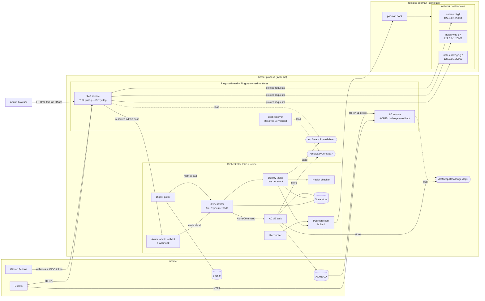
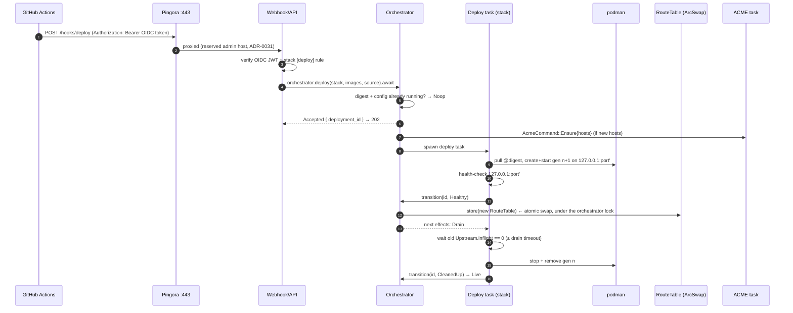
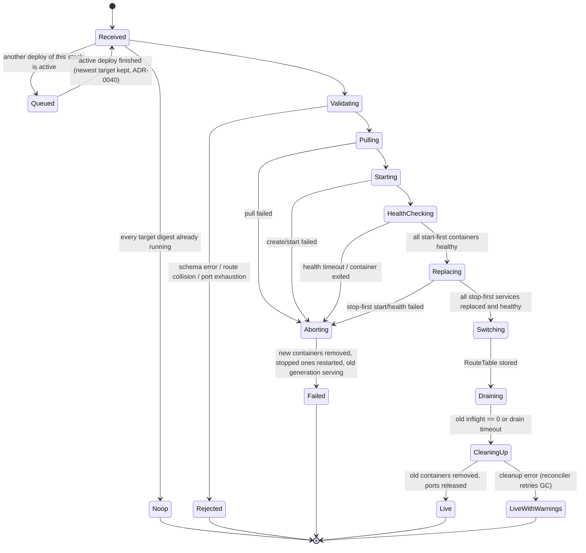

# hoster — architecture

Status: draft, 2026-11-07. Decisions referenced as **ADR-NNNN** are settled (see [adr/](adr/)).
Items marked **OQ-NN** are open; see [open-questions.md](open-questions.md).

## 1. Verified against

The library behaviour this design depends on was checked against crate sources and live systems on
2026-11-07, not taken from memory.

| Topic | Version checked | How it was checked | Finding |
|---|---|---|---|
| Pingora | `pingora` / `pingora-core` / `pingora-proxy` / `pingora-rustls` **0.9.1** (released 2026-11-03), MSRV 1.85 | crate source | See §1.1. |
| Pingora + rustls dynamic certs | pingora-core 0.9.1, `listeners/tls/rustls/mod.rs` | crate source | `TlsSettings::set_cert_resolver(Arc<dyn ResolvesServerCert>)` exists. When it is set, cert/key paths are ignored. The rustls backend does **not** call `TlsAccept::certificate_callback`; it logs a warning pointing to `ResolvesServerCert`. That callback only works on the OpenSSL/BoringSSL backends. `pingora-rustls` depends on `rustls 0.23` with the **`ring`** provider and installs it as the process default. Current rustls is 0.23.46. |
| instant-acme | **0.8.5** | crate source + `examples/provision.rs` | See §1.2. |
| bollard | **0.21.1** (bollard-stubs `=1.53.1-rc.29.3.1`) | crate source | See §1.3. |
| ghcr tag → digest | registry API, live | `curl` against `ghcr.io` | See §1.4. |
| Rootless podman, 127.0.0.1 publishing | podman **6.1.4**, netavark, pasta 2026_10_02, rootless | live probe through the compat API | See §1.5. |
| Supporting crates | `arc-swap` 1.9.3, `tokio` 1.54.1, `sqlx` 0.9.0 (ADR-0022) | crates.io | Current versions; no API concerns. |
| GitHub Actions OIDC (OQ-29) | discovery document, live | `curl` of `token.actions.githubusercontent.com/.well-known/openid-configuration` | Issuer `https://token.actions.githubusercontent.com`, JWKS at `/.well-known/jwks`, RS256. Claims include `repository_id`, `ref`, `ref_protected`, `environment`, `job_workflow_ref` and `jti`. |
| Admin UI stack (ADR-0021) | `axum` 0.8.9, `askama` 0.16.1, `oauth2` 5.0.0, `tower-sessions` 0.15.0, htmx.org **4.0.1** (npm, 2026-11-01; npm `latest` tag still points at 2.0.11, `next` at 4.0.1) | crates.io / npm registry | Versions noted for the plan. APIs not yet exercised. |
| Pingora Unix-socket upstreams | pingora-core 0.9.1 | crate source | `HttpPeer::new_uds(path, tls, sni)` exists, so the proxy can reach the admin Axum app over a Unix socket (ADR-0031). |

### 1.1 Pingora 0.9.1

- **How `Server::run` works.** `Server::run(self, RunArgs)` blocks the calling thread. It builds
  its own tokio runtimes: one per service, sized by `ServerConf::threads` or a per-service
  override, plus a one-thread "Server" runtime for the main loop. It returns after shutdown.
- **Avoid `run_forever`.** `Server::run_forever()` calls `std::process::exit(0)`, and daemon mode
  forks. hoster uses neither.
- **Shutdown is pluggable.** `RunArgs { shutdown_signal: Box<dyn ShutdownSignalWatch> }` takes any
  async `recv() -> ShutdownSignal`, with variants `GracefulUpgrade`, `GracefulTerminate` and
  `FastShutdown`. The default watcher installs SIGQUIT/SIGTERM/SIGINT handlers. hoster supplies a
  channel-backed watcher instead, so signals stay with the orchestrator.
- **Readiness.** `Server::watch_execution_phase()` returns a broadcast receiver of
  `ExecutionPhase` (`Bootstrap` → `Running` → `GracefulTerminate` → … → `Terminated`). hoster uses
  `Running` as its "proxy is up" signal. Caveat (found while implementing): `Running` is sent
  when the main loop starts, *before* the service tasks bind their listeners, and a bind failure
  only panics inside the service task; Pingora keeps running without the listener. hoster
  therefore checks the listen address with a plain `bind` before spawning the thread and, after
  `Running`, waits until a TCP connect to the listener succeeds.
- **The grace period is a fixed sleep.** On `GracefulTerminate` Pingora sleeps the whole
  `grace_period_seconds` (an uninterruptible `thread::sleep`), even with no requests in flight.
  A later `FastShutdown` cannot cut it short, so a fast shutdown waits only briefly for the
  thread and then exits without it.
- **Grace period default.** `grace_period_seconds` defaults to **300 s**, and
  `graceful_shutdown_timeout_seconds` to 5 s. Both must be set explicitly so they fit systemd's
  `TimeoutStopSec`.
- **Running on its own thread is supported.** Nothing in `run` requires the main thread, so
  hoster runs it on a `std::thread` next to the orchestrator's tokio runtime. tokio channels work
  across runtimes.
- **Per-peer timeouts.** `PeerOptions` on `HttpPeer` exposes `connection_timeout`,
  `total_connection_timeout`, `read_timeout`, `write_timeout` and `idle_timeout`.
- **Proxy hooks.** `ProxyHttp` provides `early_request_filter`, `request_filter`, `upstream_peer`,
  `upstream_request_filter`, `response_filter`, `logging` and others. `logging` runs once per
  request on success or fatal error.

### 1.2 instant-acme 0.8.5

- **Flow.** `Account::builder()?.create(&NewAccount{..}, directory_url, None)` returns
  `(Account, AccountCredentials)`. `AccountCredentials` is serde (de)serializable for
  persistence, and `AccountBuilder::from_credentials` restores an account. An order goes
  `account.new_order(&NewOrder::new(&[Identifier::Dns(..)]))` → `order.authorizations()` →
  `authz.challenge(ChallengeType::Http01)`.
- **What to serve for HTTP-01.** The `ChallengeHandle` derefs to `Challenge { token, .. }`, and
  `key_authorization().as_str()` is the response body for
  `/.well-known/acme-challenge/<token>`. Then `set_ready()` → `poll_ready(&RetryPolicy)` →
  `finalize()` → `poll_certificate(&RetryPolicy)`.
- **Key generation needs `rcgen`.** `finalize()` generates the key and CSR and returns the private
  key PEM, but only with the `rcgen` feature. `finalize_csr()` takes your own CSR.
- **Renewal info.** ARI (`Account::renewal_info`, RFC 9773) is available behind the `time`
  feature.
- **Crypto provider.** The default features pull in **aws-lc-rs**, while Pingora uses **ring**.
  instant-acme has a `ring` feature, and hoster uses ring throughout (ADR-0037).

### 1.3 bollard 0.21.1

- **Podman is supported directly.** bollard documents podman as a first-class target.
  `Docker::connect_with_podman_defaults()` probes `$DOCKER_HOST` →
  `$XDG_RUNTIME_DIR/podman/podman.sock` → `/run/user/$UID/podman/podman.sock` → system socket.
  `connect_with_unix(path, timeout, version)` is the explicit form.
- **Pitfall: the API version must be negotiated.** bollard's `API_DEFAULT_VERSION` is **1.53**, but
  podman 6.1.4's Docker-compatible API reports **`ApiVersion` 1.44** (`MinAPIVersion` 1.24). The
  client must call `Docker::negotiate_version()` right after connecting, which downgrades to the
  server's version. Pinning 1.44 is the alternative. A `/v1.53/_ping` happened to succeed, but
  hoster must not rely on podman accepting versions it does not advertise.

### 1.4 ghcr tag → digest

Checked live against a public image:

1. `GET https://ghcr.io/token?scope=repository:<owner>/<name>:pull&service=ghcr.io` returns
   `{"token": …}`. This works anonymously for public images. Private images need basic auth with
   a GitHub username and a token that has `read:packages` (ADR-0025).
2. `HEAD https://ghcr.io/v2/<owner>/<name>/manifests/<tag>` with `Authorization: Bearer <token>`
   and an `Accept` header listing the OCI index, Docker manifest list, OCI manifest and Docker v2
   manifest media types returns `200` and `Docker-Content-Digest: sha256:…`.
3. Without a token the registry answers `401` with
   `WWW-Authenticate: Bearer realm="https://ghcr.io/token",service="ghcr.io",scope="repository:…:pull"`,
   so the token step can also be discovered generically.

For multi-arch images the digest is the **index** digest. hoster records and compares the
requested reference digest, stored in a container label, rather than podman's image ID, which is
platform-specific.

### 1.5 Rootless podman publishing on 127.0.0.1

Probed through the Docker-compat API on `/run/user/1000/podman/podman.sock`, the same path bollard
uses:

1. Created a user-defined network (netavark bridge).
2. Created a container on it with `HostConfig.PortBindings = {"8000/tcp": [{"HostIp": "127.0.0.1", "HostPort": "18777"}]}`.
3. Started it and observed:
   - The listener is `127.0.0.1:18777`, owned by podman's **`rootlessport`** process.
   - `curl 127.0.0.1:18777` → 200.
   - `curl <host public IP>:18777` → connection refused.
   - Inspect reported `Ports: {'8000/tcp': [{'HostIp': '127.0.0.1', 'HostPort': '18777'}]}`.
4. Cleaned up the container and network.

Container IPs live inside the rootless network namespace and cannot be reached from the host. This
is why published loopback ports are the only path from the proxy to a container, which matches
ADR-0007.

## 2. Component overview



The admin web UI and the webhook are one Axum app. It is reached through a reserved admin-host
route in Pingora. Pingora reaches it through a Unix-socket upstream (ADR-0031).

### 2.1 Components

| Component | Runs on | Responsibility |
|---|---|---|
| **Supervisor** (`main`) | main thread → orchestrator runtime | Loads config, builds the orchestrator runtime, starts everything in order (§4), owns OS signals, coordinates shutdown. |
| **Orchestrator** | orchestrator runtime, `Arc<Orchestrator>` shared by all callers (ADR-0050) | The single writer of desired state. Exposes async methods (`apply`, `deploy`, `remove`, `rollback`, `status`, `transition`) to the web UI, webhook, poller and reconciler; applies idempotency by digest and config hash; enforces at most one deploy per stack; spawns deploy tasks; owns `ArcSwap<RouteTable>` writes. One internal `Mutex<State>` held only for in-memory work. |
| **Deploy task** | orchestrator runtime, one per active stack deploy | Runs the deploy state machine (§5) for one stack by executing effects and calling `orchestrator.transition(id, event)` after each step. |
| **Reconciler** | orchestrator runtime | Startup: compares persisted state with `podman ps` by label, then adopts, restarts or removes containers. Periodic (about every 15 s): restarts exited containers with backoff and flags CrashLooping (ADR-0028). |
| **Podman client** | orchestrator runtime | A thin `ContainerRuntime` trait over bollard (network, pull, create, start, stop, remove, inspect, list, logs). Production uses `PodmanRuntime`; tests use a fake. |
| **State store** | orchestrator runtime | SQLite via sqlx (ADR-0022): `SqlitePool`, WAL mode, embedded migrations, compile-time checked queries. Persists stacks, deployments, digests, generations, port allocations, deploy history, sessions. |
| **Health checker** | orchestrator runtime | Probes new containers on their `127.0.0.1` port before the swap, with HTTP or TCP probes (ADR-0038). Afterwards, periodic probes feed status only. |
| **ACME task** | orchestrator runtime, single task | Account lifecycle, issuance, renewal. Writes `CertMap` and `ChallengeMap`. Persists account and certs to disk. |
| **Registry client** | orchestrator runtime | Generic OCI distribution client (ADR-0025): token discovery from `WWW-Authenticate`, `HEAD` manifest → digest. Per-registry-host credentials. Used by the poller and for resolving third-party tags at stack apply. |
| **Digest poller** | orchestrator runtime | Periodically resolves tracked ghcr tags to digests. Calls `orchestrator.deploy` only when a tag's observed digest changes (ADR-0043). |
| **Admin web UI + webhook (Axum)** | orchestrator runtime | One Axum app (ADR-0021).<br/>• **UI:** Askama-rendered pages with vendored HTMX 4 (embedded in the binary). GitHub OAuth login, restricted to `HOSTER_ADMIN_GITHUB`. SQLite sessions and CSRF tokens (ADR-0031).<br/>• **Webhook:** `/hooks/deploy`, authenticated with a GitHub Actions OIDC token (signature via a cached JWKS, `iss`, `aud`, expiry, single-use `jti`) and authorized by the stack's `[deploy]` rule (ADR-0047).<br/>• **Wiring:** calls `Orchestrator` methods directly and renders their typed results. Live views (deploy progress, logs) stream through SSE or HTMX polling. |
| **GitHub OAuth client** | orchestrator runtime | Authorization-code + PKCE flow against github.com. Compares the login handle case-insensitively with `HOSTER_ADMIN_GITHUB` (ADR-0031). |
| **:80 service** | Pingora | Answers `/.well-known/acme-challenge/<token>` from `ChallengeMap`. Redirects every other request to `https://` with 308. |
| **:443 service** | Pingora | TLS via rustls with `CertResolver`. `ProxyHttp` routes against `RouteTable`. |
| **CertResolver** | Pingora handshake path | `impl rustls::server::ResolvesServerCert`. Looks up SNI in `CertMap`. |

## 3. Threads, runtimes and channels

### 3.1 Threads

```
process hoster
├── main thread ── #[tokio::main] orchestrator runtime (multi-thread, N workers)
│                  supervisor, orchestrator, deploy tasks, ACME, poller, API, reconciler
└── "pingora" std::thread ── pingora_core::server::Server::run(RunArgs{ custom watcher })
                 ├── Pingora "Server" runtime (1 thread): main loop, awaits our ShutdownSignalWatch
                 ├── ":80" service runtime  (ServerConf.threads or per-service override)
                 └── ":443" service runtime (ServerConf.threads)
```

- The proxy's hot path never shares a runtime with orchestrator work. A slow image pull or a
  blocking podman call cannot add latency to requests, and the reverse is also true.
- The Pingora thread is spawned **after** the initial state is loaded (§4). That way the first
  request already sees a populated `RouteTable` and `CertMap`.
- `ServerConf` is built in code: `daemon = false`, no upgrade socket, explicit
  `grace_period_seconds` and `graceful_shutdown_timeout_seconds`, `threads` from hoster config.
  Pingora's own CLI/YAML parsing is not used.

### 3.2 Shared state: ArcSwap snapshots

The Pingora side reads all mutable state through lock-free `ArcSwap::load()` on immutable
snapshots. Every snapshot has exactly one writer.

| Snapshot | Type (sketch) | Writer | Readers | Update pattern |
|---|---|---|---|---|
| `RouteTable` | `ArcSwap<RouteTable>` | Orchestrator (inside `transition`, ADR-0050) | :443 `ProxyHttp` | Rebuild the whole table from desired state, then `store`. |
| `CertMap` | `ArcSwap<HashMap<String, Arc<CertifiedKey>>>` | ACME task (and startup loader) | `CertResolver` | Clone, insert/replace one host, `store`. |
| `ChallengeMap` | `ArcSwap<HashMap<String, String>>` (token → key authorization) | ACME task | :80 service | Insert before `set_ready()`; remove when the order finishes. |

`RouteTable` entries hold `Arc<Upstream>`:

```rust
struct Upstream {
    addr: SocketAddr,           // 127.0.0.1:<allocated>
    stack: StackId, service: ServiceName, generation: u64,
    inflight: AtomicU64,        // requests currently proxied to this upstream
}
```

The proxy increments `inflight` when it picks an upstream. It keeps an RAII guard in the request
`CTX` that decrements on drop, so cancelled and errored requests are counted correctly. The deploy
task keeps its own `Arc<Upstream>` for the old container. After the swap it watches `inflight`
reach zero to know the drain is done (§5.3). No message from the proxy is needed.

### 3.3 Channels

Requests into the orchestrator are **method calls** on `Arc<Orchestrator>` (ADR-0050): the web
UI, webhook, poller and reconciler call `apply`, `deploy`, `remove`, `rollback` and `status` and
receive typed results; deploy tasks call `transition(deployment_id, event)`. Channels are used only
where a boundary needs them:

| # | Channel | Type | From → To | Purpose |
|---|---|---|---|---|
| 1 | `acme_tx` | `mpsc::Sender<AcmeCommand>` | Orchestrator → ACME task | `Ensure { hosts }` when the set of routed hosts changes, `Forget { host }`. |
| 2 | `acme_events` | `mpsc::Sender<AcmeEvent>` | ACME task → Orchestrator | `Issued { host, not_after }`, `Failed { host, error, retry_at }`. The orchestrator records them and fans them out on `ui_events` (#5), so each channel has one producer. Used for status ("TLS pending") in the UI; deploys never wait on certificates (ADR-0036). |
| 3 | `pingora_shutdown` | `watch::Sender<Option<ShutdownSignal>>` | Supervisor → Pingora "Server" runtime | Read by our `ShutdownSignalWatch` impl. SIGTERM becomes `GracefulTerminate`, a second SIGTERM or SIGINT becomes `FastShutdown`. |
| 4 | `pingora_phase` | `broadcast::Receiver<ExecutionPhase>` | Pingora → Supervisor | `Running`, followed by a successful connect to the listener (§1.1), means the listeners are bound and the ACME task may start. An early `Terminated` means Pingora died, and the supervisor exits non-zero. |
| 5 | `ui_events` | `broadcast::Sender<UiEvent>` | Orchestrator → Axum SSE handlers | Deploy progress, health changes and cert events (relayed from #2), pushed to open UI pages (HTMX SSE). Lagging receivers just re-render from current state. |
| 6 | `shutdown` | `CancellationToken` (tokio-util) | Supervisor → all orchestrator tasks | Cooperative cancellation. Deploy tasks stop at the next safe point (§5.4). |



The orchestrator performs the swap inside `transition`, not the deploy task. A single writer
builds `RouteTable` from the full desired state of every stack, so concurrent deploys of different
stacks can never overwrite each other's routes (ADR-0035 #1, ADR-0050).

## 4. Startup and shutdown order

**Startup**

1. Parse config (`~/.config/hoster/hoster.toml` + `HOSTER_*` env, ADR-0024) and initialize tracing.
2. Open the SQLite state store (sqlx pool, WAL mode) and run the embedded `sqlx::migrate!()` migrations.
3. Load the certificates on disk into `CertMap`. Expired ones are skipped and queued for
   issuance.
4. Connect to podman, run `negotiate_version()` and `ping()`. The socket comes from the same
   user's `podman.socket` unit (ADR-0023). Fail fast with a clear message if it is missing.
5. Reconcile: list containers by the `hoster.managed=true` label and compare with persisted
   state. Adopt running containers of the current generation, start or recreate missing ones,
   remove orphans from interrupted deploys (§5.4).
6. Build and store the initial `RouteTable`.
7. Spawn the Pingora thread and wait for `ExecutionPhase::Running`. If it fails to bind :80/:443,
   exit non-zero so systemd shows the failure.
8. Start the ACME task (renewals plus any missing certs, the admin host included), the poller and
   the Axum app (web UI + webhook).
9. Notify systemd that the service is ready (`READY=1` with `Type=notify`).

**Shutdown** (SIGTERM)

1. Cancel the poller and the Axum app, and stop accepting new commands.
2. Let in-flight deploy tasks reach a safe point (§5.4), then persist.
3. Send `GracefulTerminate` to Pingora. Pingora stops accepting, waits `grace_period_seconds`,
   then shuts its runtimes down with `graceful_shutdown_timeout_seconds`.
4. Join the Pingora thread and exit 0.

App containers keep running when hoster stops. They are owned by podman/conmon, not by the
hoster process. While hoster is down there is no proxy, so the apps are unreachable for about 1–2 s (ADR-0034).

## 5. Deploy state machine

### 5.1 States

A **deployment** is one attempt to move a stack from its current digest set to a target digest set.
It is persisted with every transition, so a crash can be recovered from (§5.4).



| State | Work | Side effects | On failure |
|---|---|---|---|
| **Received** | Compare target digests with running ones per service. | none | — |
| **Validating** | Parse the stack, check route collisions against other stacks' routes, allocate new ports for routed services that change, assign generation *n+1*. | Port allocations reserved (persisted). | → `Rejected`, reservations released. |
| **Pulling** | Pull every changed image `repo@digest`, with credentials if configured. | Images in local storage. | → `Aborting`. |
| **Starting** | Ensure network `hoster-<stack>`. For each changed **start-first** service, create and start `hoster-<stack>-<svc>-g<n+1>` with labels, the network alias `<svc>`, and `127.0.0.1:<port>` publishing for routed services. | New containers running next to the old ones. | → `Aborting`. |
| **HealthChecking** | Probe each new start-first container on its loopback port (or by the service's check type) until it passes, it times out, or the container exits. | none | → `Aborting`. |
| **Replacing** | For each changed **stop-first** service, one at a time (ADR-0048): publish a `RouteTable` with its routes `Unavailable`, stop the old container (keep it), start the new one, probe it. Empty when no stop-first service changed. | Old stop-first containers stopped; new ones running. 503 for their routes meanwhile. | → `Aborting`. |
| **Switching** | The deploy task calls `transition(id, Healthy)`. The orchestrator rebuilds `RouteTable` with every changed service's new upstream and `store`s it, then writes all per-service pointers in one transaction. | Traffic moves atomically for the whole stack. | Cannot fail once in memory. A persist failure is fatal and logged; the reconciler fixes it at next start. |
| **Draining** | Wait for `old_upstream.inflight == 0`, polled every 100 ms, or for the per-stack drain timeout. Keep-alive connections that are idle at Pingora's upstream pool are fine. New requests already go to the new upstream, and the old container is only stopped after this state. | none | Timeout → proceed; long-lived requests (SSE, WebSockets) get cut. |
| **CleaningUp** | Stop old containers (SIGTERM, then the stop timeout), remove them, release their ports. | Old generation gone. | → `LiveWithWarnings`. The reconciler garbage-collects later. |
| **Aborting** | Stop and remove the new generation's containers, start any stop-first containers that `Replacing` stopped and restore their routes, release reserved ports. | Back to the previous state. | Leftovers labelled with the aborted generation are GC'd by the reconciler. |

Non-routed services (no ports, e.g. a worker) follow the same sequence. They have no upstream to
swap, so "Switching" only records the new generation and draining is skipped. Services that must
not run twice at once, e.g. anything holding an exclusive lock on a volume, need a stop-first
variant, `update = "stop-first"` (ADR-0039). Stop-first services are replaced in the `Replacing`
step, after every start-first service is healthy and before the single swap, so a deployment is
always one atomic change to the stack (ADR-0048).

**Generations and the commit point.** The generation counter is per stack and is assigned to each
deployment attempt, but it is **recorded per service**: a deployment recreates only the services
whose digest or config hash changed, so after a webhook that updates `api` alone, `api` is at
g*n+1* while `web` and `storage` stay at g*n* (stack-format §3.1). The durable truth is therefore
the set of per-service current pointers (generation, digest, config hash, ports) for the stack.
The commit point of a deployment is the single transaction that writes all of them.

The state machine is implemented once, as a pure transition function with the full state set
above, and is already in place in M3 before the proxy exists. There, `HealthChecking` uses only
the built-in "running for 5 s" check, `Switching` writes the pointers without publishing a
`RouteTable`, and `Draining` completes at once. M6 replaces those effects with real probes, the
swap and the inflight drain without changing the states or transitions.

### 5.2 Idempotency and coalescing

- **Running-set check.** The orchestrator keeps, per stack, the (digest, config hash) each service
  is running (in memory, backed by the store). `Deploy` with an identical set → `Noop` (ADR-0005 as
  refined by ADR-0029). The check applies to the
  webhook, the poller and manual deploys alike.
- **One deploy per stack.** While a stack has an active deployment, new commands for it are
  queued (ADR-0040). The queue keeps only the newest target, and when the active deploy
  ends the orchestrator re-runs the idempotency check against it. Different stacks deploy in parallel.

### 5.3 Draining

- **Mechanism.** Draining relies on per-upstream `inflight` counters (§3.2). Each new container
  gets a fresh port, and Pingora keys its upstream connection pool by peer address. So no pooled
  connection to the old container can be reused for a request routed to the new one. Idle pooled
  connections to the old port die when the container stops, and that is harmless because no new
  request is ever routed there.
- **Edge case.** A request may have loaded the old `RouteTable` snapshot just before the swap but
  not yet incremented `inflight`. The deploy task waits a short **settle delay** (e.g. 1 s) after
  the swap before it starts checking `inflight == 0`.

### 5.4 Crash recovery

Each persisted state tells the reconciler what to do at startup:

| Persisted state at crash | Recovery |
|---|---|
| `Validating`, `Pulling` | Mark `Failed (interrupted)`, release reservations. |
| `Starting`, `HealthChecking`, `Replacing` | Remove containers of generation *n+1*, start any stopped stop-first containers of the previous generation, mark `Failed (interrupted)`. The old generation keeps serving. |
| `Switching` with the per-service pointers not yet written | The swap never happened in a running proxy (the table is in memory), so treat it like `HealthChecking`. |
| `Draining`, `CleaningUp` (pointers written) | The new pointers are authoritative: remove the containers of every service's previous generation, mark `Live`. |

The per-service current pointers are the one durable fact that decides which containers are
routed. Writing them in one transaction is the commit point of a deploy (§5.1).

## 6. Routing

### 6.1 RouteTable structure

```rust
struct RouteTable {
    hosts: HashMap<String /* lowercased, no port, no trailing dot */, HostRoutes>,
    version: u64,
}
struct HostRoutes {
    // sorted by number of path segments, descending: longest prefix first
    routes: Vec<RouteEntry>,
}
struct RouteEntry {
    prefix: Vec<String>,          // "/api/v1" → ["api","v1"]; "/" → []
    prefix_str: String,           // "/api/v1", for X-Forwarded-Prefix and strip
    strip_prefix: bool,
    target: Target,
    timeouts: RouteTimeouts,      // connect, read, write, idle (ADR-0011)
}
enum Target {
    Loopback(Arc<Upstream>),                   // a routed service: 127.0.0.1:<port>, inflight counter (§3.2)
    Unix(Arc<UnixUpstream>),                   // the admin app on its Unix socket (ADR-0031); HttpPeer::new_uds
    Unavailable { retry_after: Duration },     // a stop-first service in its gap: 503 + Retry-After (ADR-0039, ADR-0032)
}
```

The three target kinds exist from the first version of the table. The admin host entry is
injected by `RouteTable::build` from config, not declared by any stack, and takes part in the
collision check as reserved (ADR-0031).

### 6.2 Matching (ADR-0009)

1. **Host.** Take the request host from `:authority` (HTTP/2) or the `Host` header (HTTP/1.1).
   Lowercase it, then strip the port and any trailing dot. Look it up exactly; there are no
   wildcards (DNS-01 is deferred).
2. **Path.** Split the path (without the query) on `/`. Pick the first `RouteEntry` whose
   `prefix` segments equal the leading segments of the path. Segment comparison ensures that
   `/api` matches `/api`, `/api/` and `/api/users`, but not `/apiary`.
3. **No match.** Unknown host or no matching prefix → built-in responses per ADR-0032 (404; 421 on Host/SNI mismatch).

Collision detection (ADR-0012) uses the same normalization. Two routes collide when they have the
same host and the same normalized prefix segments. Different prefixes on the same host owned by
different stacks are allowed, e.g. stack A at `/` and stack B at `/blog`. Longest-prefix matching
makes that well-defined.

### 6.3 Request rewriting (ADR-0010)

In `upstream_request_filter`:

- **`Host`** is left exactly as the client sent it.
- **Prefix stripping.**
  - If `strip_prefix` is set, the matched prefix segments are removed from the path, and the
    query is kept.
  - If nothing is left, the path becomes `/`.
  - Example: with prefix `/api`, `/api/users?x=1` → `/users?x=1` and `/api` → `/`.
- **`X-Forwarded-Prefix: <prefix_str>`** is set either way. It is omitted for the root prefix
  `/`. Any client-supplied value is overwritten.
- **Other forwarding headers.**
  - `X-Forwarded-For` is appended to.
  - `X-Forwarded-Proto: https` and `X-Forwarded-Host: <host>` are set.
  - Client-supplied `X-Forwarded-Proto`, `X-Forwarded-Host` and `X-Forwarded-Prefix` are
    overwritten. hoster is the edge, so incoming values are untrusted.
- **Bodies are streamed.** Pingora streams by default, and hoster installs no body filters that
  buffer (ADR-0011).

### 6.4 How the RouteTable is updated

1. **When.** The orchestrator rebuilds the table after any of these:
   - a deploy reaches `Switching`
   - a stop-first service enters its gap in `Replacing` (its routes become `Unavailable`), and
     when an abort restores it
   - a stack is removed
   - reconciliation at startup
   - a rollback
2. **Input.** The build reads the orchestrator's in-memory desired state: for each stack, the
   current generation's upstreams and its routes.
3. **Build.** `RouteTable::build(&desired) -> Result<RouteTable, CollisionError>` is a pure
   function, unit-testable without Pingora.
   - It runs the same collision check as validation as a last line of defense.
   - It bumps `version`.
4. **Publish.** `routes.store(Arc::new(table))`. Requests in flight keep the snapshot they loaded,
   and the next `load()` sees the new one.
5. **Log.** The version and a diff summary are logged. The previous table's `Arc<Upstream>`s stay
   alive while any request or deploy task still holds them, which is what makes draining work.

## 7. TLS and ACME

### 7.1 TLS (ADR-0014)

- **Listener.** `TlsSettings::with_callbacks(..)` or the equivalent is used with
  `set_cert_resolver(Arc::new(CertResolver { map }))` and then `enable_h2()` (ADR-0033). It is
  attached with `service.add_tls_with_settings("[::]:443", None, settings)`.
- **Resolver.** `CertResolver::resolve(ClientHello)`:
  1. Takes `server_name()`, lowercases it, and loads `CertMap`.
  2. On a hit returns that host's `Arc<CertifiedKey>`. On a miss returns `None`, which fails the
     handshake (ADR-0032).
- **Host vs SNI.** A `TlsAccept::handshake_complete_callback` stores the handshake's SNI name in
  the connection's `SslDigest` extension. The routing proxy compares every request's host
  (`:authority` or `Host`, without port or trailing dot, any case) with it and answers `421` on a
  mismatch (ADR-0032).
- **Building certified keys.** `CertifiedKey`s are built with the same rustls crypto provider
  Pingora installs (`ring`), using `rustls::crypto::ring::sign::any_supported_type`.

### 7.2 Port 80 (ADR-0015)

The `:80` service implements `request_filter`:

1. If the path is `/.well-known/acme-challenge/<token>`, it answers with
   `ChallengeMap[token]` (`200 text/plain`) or `404`.
2. Otherwise, for a host in the `RouteTable`, it answers `308 Permanent Redirect` to
   `https://<host><path+query>` (host lowercased, without port). Any other host gets `404`
   (ADR-0032).

It never proxies.

### 7.3 ACME task (ADR-0015, ADR-0016)

```
loop select! {
  cmd = acme_rx.recv()       => Ensure{hosts}: for each host without a valid cert → issue()
  _   = renewal_tick (1h)    => for each cert with < 1/3 lifetime left (or ARI window) → issue()
  _   = shutdown.cancelled() => break
}

issue(host):
  account = load_or_create()                 // credentials JSON persisted, mode 0600
  order   = account.new_order([Dns(host)])
  for authz: ch = authz.challenge(Http01)
             ChallengeMap.insert(ch.token, ch.key_authorization())
             ch.set_ready()
  order.poll_ready(); key_pem = order.finalize(); chain = order.poll_certificate()
  write certs/<host>/{fullchain.pem, privkey.pem} atomically (tmp + rename)
  CertMap.insert(host, CertifiedKey::from(chain, key))
  ChallengeMap.remove(tokens)
  acme_events.send(Issued{host, not_after})
```

- **One certificate per hostname.** Each cert has a single SAN. That keeps issuance failures
  isolated and avoids HTTP/2 connection coalescing across hosts.
- **Failure handling.** Failures back off exponentially per host, starting at 5 minutes and capped
  at 24 hours, which stays well inside Let's Encrypt's failed-validation limits. The directory URL
  is configurable, and staging is recommended for first runs.

### 7.4 On-disk layout

Under hoster's state directory, `~hoster/.local/share/hoster` (ADR-0023):

```
hoster.db         # SQLite state store (ADR-0022), plus -wal/-shm files
acme/account.json # instant-acme AccountCredentials (0600)
certs/<host>/fullchain.pem
certs/<host>/privkey.pem   (0600)
certs/<host>/meta.json     # not_after, issued_at, CA directory, ARI cert id
registries/<registry-host> # `username:token` pull credential (0600), until the secret store (ADR-0029)
```

## 8. Podman conventions

| Object | Name | Labels |
|---|---|---|
| Network | `hoster-<stack>` | `hoster.managed=true`, `hoster.stack=<stack>` |
| Container | `hoster-<stack>-<service>-g<generation>` | `hoster.managed=true`, `hoster.stack`, `hoster.service`, `hoster.generation`, `hoster.image=<repo>`, `hoster.digest=<requested digest>`, `hoster.deployment=<id>` |
| Volume | `hoster-<stack>-<volume>` (ADR-0030) | `hoster.managed=true`, `hoster.stack` |

- **Service discovery.** Each container joins its stack network with the alias `<service>`, so
  `http://storage:9000` works inside the stack through netavark/aardvark-dns. During a deploy's
  overlap window, the alias resolves to both generations.
- **Port publishing.** Only routed services publish ports:
  `PortBindings = {"<container_port>/tcp": [{"HostIp":"127.0.0.1","HostPort":"<allocated>"}]}`.
  A service with several routes to different container ports gets one allocated host port per
  distinct container port.
- **No host access for apps.** No container is ever given the podman socket, a bind mount of
  host paths outside its volumes, `--privileged`, or host networking (ADR-0019).

## 9. Security boundaries

| Boundary | Control |
|---|---|
| Internet → hoster | Only :80 (challenge + redirect) and :443 (TLS-terminated, routed) are exposed. |
| Admin → hoster | The web UI sits on a reserved admin host. Requests need a session from GitHub OAuth, and only the account whose handle matches `HOSTER_ADMIN_GITHUB` is accepted (ADR-0031). Axum listens on a 0600 Unix socket, so containers can't reach it. State-changing requests are POSTs with CSRF protection. A strict CSP is possible because all assets are embedded (ADR-0021). |
| Internet → apps | Only through declared routes. Container ports are bound to loopback only (§1.5). |
| CI → hoster | A GitHub Actions OIDC ID token in `Authorization: Bearer`. hoster checks the RS256 signature against GitHub's JWKS, the issuer, the audience (the admin host by default), the expiry, and that the `jti` hasn't been used before. The claims must satisfy the stack's `[deploy]` rule (`repository_id` required, optional refs/environment/workflow). Each digest must belong to its service's configured repo. No shared secret exists (ADR-0042, ADR-0047). |
| hoster → podman | The rootless socket of hoster's own user. A podman compromise is bounded by that user's privileges. |
| Apps → host | Rootless user namespaces. No socket, no privileged mode, own network per stack. The admin app listens on a 0600 Unix socket, so containers cannot reach it even if they can reach host loopback (ADR-0031). |
| Secrets at rest | Account key and cert keys are `0600`. App secrets are encrypted with XChaCha20-Poly1305 in SQLite, with the key in a separate 0600 file or a user systemd credential (ADR-0029). |

## 10. Crate and module layout (proposal)

A single binary crate to start, with modules that can later become workspace crates:

```
src/
  main.rs            supervisor, startup/shutdown order
  config.rs          hoster.toml
  stack/             stack file model, parsing, validation (pure)
  routing/           RouteTable, matching, collision check (pure)
  orchestrator/      Orchestrator handle (ADR-0050), deploy state machine, deploy tasks, reconciler
  runtime/           ContainerRuntime trait, bollard PodmanRuntime, fake for tests
  store/             SQLite via sqlx (ADR-0022); migrations/ and .sqlx/ at the crate root
  proxy/             Pingora thread, :80 and :443 services, CertResolver
  acme/              ACME task, cert storage
  registry/          generic OCI registry client (token discovery, HEAD manifest), poller
  web/               Axum app: admin UI routes, GitHub OAuth, sessions, webhook handler
templates/           Askama templates (compiled in)
assets/              vendored htmx 4.0.x + CSS (embedded via include_bytes!/rust-embed)
```

The pure modules (`stack`, `routing`, the deploy state transition function) carry most of the unit
tests. `runtime` gets integration tests against a real rootless podman, gated by an env var.
